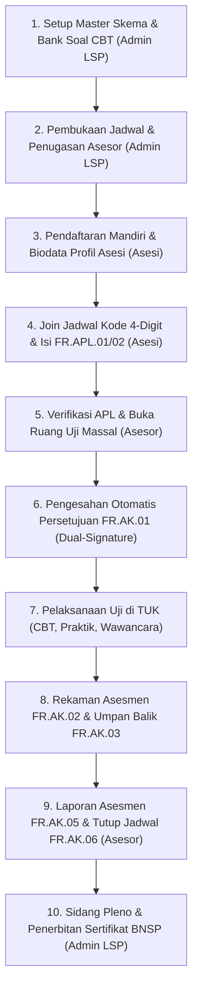

# LSP PrO Indo — Sistem Sertifikasi Kompetensi Profesi (Audit Ready BNSP)

Aplikasi web terpadu Lembaga Sertifikasi Profesi Praktisi Otomotif Indonesia (**LSP PrO Indo**) berlisensi resmi **Badan Nasional Sertifikasi Profesi (BNSP)**. Sistem ini mendigitalisasi seluruh tahapan asesmen kompetensi teknisi otomotif dengan arsitektur ramping (*lean*), efisien di lapangan (TUK), serta kepatuhan format 1:1 terhadap instrumen Materi Uji Kompetensi (MUK) resmi BNSP.

---

## 1. Arsitektur Aktor (Tepat Tiga Aktor)

Sistem beroperasi tepat dengan tiga aktor utama tanpa perantara:

1. **`ADMIN_LSP` (Administrator LSP):**
   - Mengelola master data: skema sertifikasi (7 skema otomotif), hierarki unit/elemen/KUK, bank soal CBT, dan pembukaan jadwal asesmen.
   - Membuat jadwal murni administratif: memilih skema sertifikasi, nama/jenis TUK, tanggal & waktu pelaksanaan, serta menugaskan asesor. Admin **tidak dibebani pilihan instrumen teknis**.
   - Mengesahkan yudisium kelulusan pada **Sidang Pleno** serta menerbitkan nomor blanko sertifikat resmi BNSP.
   - *Catatan Mutlak:* Admin **TIDAK** ikut memeriksa atau memverifikasi berkas permohonan asesi.
2. **`ASESOR` (Asesor Kompetensi):**
   - Pemegang wewenang teknis metodologi asesmen di lapangan.
   - Memiliki fitur **Seleksi Massal (*Bulk Action* / "Pilih Banyak")**: dalam 1-klik dapat menyetujui APL, mengesahkan `FR.AK.01` dengan tanda tangan ganda, membuat draf `FR.AK.07` standar, dan membuka Ruang Uji serentak untuk puluhan asesi di TUK.
   - Menyesuaikan instrumen uji `FR.IA` yang terbuka (*unlocked*) per kandidat (misal: CBT saja, praktik observasi saja, atau seluruh paket MUK).
   - Mengarahkan proses pengujian di workshop TUK: observasi unjuk kerja (`FR.IA.01`), laporan pengukuran (`FR.IA.01B`), demonstrasi praktik (`FR.IA.02`), dan wawancara lisan PMO (`FR.IA.03`).
   - Mengisi penyesuaian yang wajar (`FR.AK.07`) 100% mandiri bila terdapat kebutuhan khusus asesi di TUK.
   - Merekam hasil asesmen kompetensi (`FR.AK.02`), menetapkan rekomendasi final (K / BK), serta menyusun laporan jadwal (`FR.AK.05`) dan kaji ulang asesmen (`FR.AK.06`).
3. **`ASESI` (Peserta Uji Sertifikasi):**
   - Mendaftar mandiri via **Kode Jadwal 4 Digit** dari TUK/penyelenggara.
   - Melengkapi biodata diri dan membubuhkan tanda tangan digital canvas satu kali di profil akun.
   - Mengisi formulir permohonan (`FR.APL.01`) dan asesmen mandiri (`FR.APL.02`).
   - Begitu disetujui asesor, asesi **tidak perlu tanda tangan manual berulang** untuk `FR.AK.01` maupun `FR.AK.07` (tanda tangan profil otomatis tersemat sah).
   - Langsung masuk Ruang Uji MUK yang terbuka (*clean progressive unlocking*): mengerjakan CBT (`FR.IA.05`) dan instruksi praktik sesuai arahan langsung asesor.
   - Mengisi umpan balik pelaksanaan asesmen (`FR.AK.03`), mengajukan banding (`FR.AK.04`) bila diperlukan, serta mengunduh e-Sertifikat resmi BNSP.

> **PENTING UNTUK AUDITOR & PENGEMBANG:**  
> Role **Komite Teknis** dan **TUK** telah dihapus secara menyeluruh dari kode, routing, enum, middleware, dan seeder. TUK hanya hadir sebagai entitas data (nama TUK, jenis TUK: Sewaktu/Mandiri/Tempat Kerja, dan alamat).

---

## 2. Alur Sertifikasi Kompetensi Terpadu (Langkah 1 s/d 10)



1. **Setup Master Skema & Soal (Admin):** Memastikan skema aktif, KUK SKKNI terpetakan, dan bank soal CBT siap.
2. **Buka Jadwal (Admin):** Input murni administratif: Skema, Nama TUK, Tanggal & Jam, dan Asesor. Sistem menerbitkan kode jadwal 4-digit unik.
3. **Biodata & TTD Profil (Asesi):** Asesi mendaftar dan membubuhkan tanda tangan digital sekali di profil akun.
4. **Pendaftaran Jadwal & Isi APL (Asesi):** Asesi memasukkan kode jadwal, melengkapi bukti portofolio dasar pada FR.APL.01, dan menilai mandiri KUK pada FR.APL.02.
5. **Verifikasi APL & Aksi Massal Asesor (Asesor):** Di menu jadwal asesi, asesor dapat memanfaatkan fitur **Pilih Semua / Seleksi Massal** untuk memvalidasi berkas dan membuka Ruang Uji banyak asesi sekaligus dalam 1-klik.
6. **Pengesahan Otomatis FR.AK.01:** Dokumen persetujuan asesmen dan komitmen kerahasiaan otomatis sah dengan tanda tangan profil kedua pihak. Asesi tidak dibebani form tanda tangan manual tambahan.
7. **Pelaksanaan Uji di TUK:** Asesi masuk ke Ruang Uji yang menampilkan hanya instrumen yang dibuka (*unlocked*): Ujian Teori CBT (`FR.IA.05`) dengan proteksi anti-hilang jawaban (*localStorage* + *auto-sync*), observasi praktik (`FR.IA.01`/`IA.01B`), demonstrasi (`FR.IA.02`), dan wawancara lisan (`FR.IA.03`).
8. **Rekaman Rekomendasi (Asesor & Asesi):** Asesi mengisi umpan balik `FR.AK.03`. Asesor membuka Tab FR.AK.02 Workspace untuk menetapkan rekomendasi akhir (KOMPETEN / BELUM KOMPETEN).
9. **Laporan & Tutup Jadwal (Asesor):** Asesor mengisi laporan pelaksanaan `FR.AK.05` dan kaji ulang `FR.AK.06`. Jadwal resmi ditutup (*locked*) demi integritas data audit.
10. **Sidang Pleno & Penerbitan Sertifikat (Admin):** Admin LSP mengesahkan hasil pleno di sistem (`/admin/pleno`), menerbitkan Nomor Sertifikat BNSP resmi (berlaku 3 tahun), dan asesi dapat mengunduh e-Sertifikat berbingkai resmi BNSP.

---

## 3. Paradigma Sistem: Modular MUK & Progressive Unlocking

> ### ⚠️ PANDUAN PENTING BAGI PENGEMBANG & AI AGENT LAINNYA
> **DILARANG** mengembalikan visual usang yang memunculkan kartu abu-abu bertuliskan *"🔒 Terkunci"*, tombol mati yang membingungkan asesi, atau memaksakan linear wizard sekuensial bertahap kaku.
>
> **Prinsip Arsitektur:**
> 1. **Progressive Unlocking:** Hanya modul dan instrumen yang aktif / terbuka yang dirender ke layar asesi. Antarmuka tetap bersih, lega, dan bebas dari elemen dekoratif mati (*anti-slop*).
> 2. **Wewenang Penentuan Instrumen:** Instrumen uji `FR.IA` ditentukan atas kesepakatan Asesor dan Asesi di `FR.AK.01`, bukan dipatok kaku oleh Admin saat membuat jadwal.
> 3. **Efisiensi Maksimal di TUK:** Di tempat uji kompetensi, waktu sangat terbatas. Asesor memiliki kontrol seleksi massal (*bulk actions*) agar tidak perlu berpindah halaman 20–30 kali untuk tugas repetitif.

### Matriks Formulir MUK:

| Kode Formulir | Nama Formulir BNSP | Pengisi | Peran & Karakteristik |
| :--- | :--- | :--- | :--- |
| **FR.APL.01** | Permohonan Sertifikasi Kompetensi | Asesi | Biodata diri, unit skema, dan upload dokumen persyaratan dasar (KTP, Ijazah, Foto). |
| **FR.APL.02** | Asesmen Mandiri K/BK | Asesi | Penilaian mandiri per KUK dengan tombol cepat *"Pilih Semua K"*. |
| **FR.AK.01** | Persetujuan Asesmen & Kerahasiaan | Sistem / Asesor | Perjanjian pelaksanaan asesmen. TTD tersemat otomatis dari profil kedua pihak saat APL disetujui. |
| **FR.IA.05** | Pertanyaan Tertulis CBT | Asesi | Ujian teori daring. Auto-grading, timer, dan penyimpanan draf instan (*dual-persistence*). |
| **FR.IA.01** | Ceklis Observasi Praktik | Asesor | Penilaian unjuk kerja demonstrasi praktik di workshop bengkel TUK. |
| **FR.IA.01B** | Lembar Laporan Pemeriksaan Teknis | Asesor | Penilaian lembar pengukuran teknis mekanikal / elektrikal kendaraan. |
| **FR.IA.02** | Tugas Praktik Demonstrasi (TPD) | Asesor | Evaluasi penyelesaian skenario tugas kerja bengkel. |
| **FR.IA.03** | Pertanyaan Mendukung Observasi (PMO) | Asesor | Pertanyaan lisan untuk konfirmasi K3 dan pemahaman dasar teori. |
| **FR.AK.07** | Penyesuaian Wajar dan Beralasan | **Asesor (100%)** | Diisi **hanya oleh asesor** bila ada kondisi darurat/kebutuhan khusus. Asesi tidak pernah mengisi form ini. |
| **FR.AK.02** | Rekaman Asesmen Kompetensi | Asesor | Matriks Unit vs Bukti, tombol cepat *"Semua K"*, rekomendasi akhir K/BK, dan tindak lanjut. |
| **FR.AK.03** | Umpan Balik Asesmen | Asesi | Evaluasi 10 butir mutu penyelenggaraan asesmen oleh asesi setelah selesai diuji. |
| **FR.AK.04** | Banding Asesmen | Asesi | Formulir pengajuan peninjauan ulang keputusan asesor (hanya aktif bila hasil Belum Kompeten). |
| **FR.AK.05** | Laporan Asesmen | Asesor | Distribusi hasil uji dan evaluasi fasilitas TUK untuk penutupan jadwal. |
| **FR.AK.06** | Meninjau Proses Asesmen | Asesor | Evaluasi 4 prinsip asesmen (Valid, Reliabel, Fleksibel, Adil). |
| **PLENO** | Berita Acara Pleno & Sertifikat | Admin LSP | Pengesahan yudisium kelulusan resmi dan penerbitan sertifikat kompetensi BNSP. |

---

## 4. Cara Menambah Modul Asesmen Baru (Panduan Masa Depan)

Bila di masa depan LSP PrO Indo mengaktifkan modul MUK baru—seperti **CRP** (Ceklis Verifikasi Portofolio), **CVP** (Ceklis Verifikasi Pihak Ketiga), atau **FR.IA.06** (Pertanyaan Esai Terstruktur)—ikuti konvensi modular berikut:

1. **Daftarkan Kode Modul:**
   Tambahkan kode (misal `CRP`, `CVP`, `IA06`) pada helper model `Assessment::getUnlockedInstruments()`.
2. **Tambahkan Tab di Workspace Asesor:**
   Buka [`resources/views/asesor/workspace/show.blade.php`](resources/views/asesor/workspace/show.blade.php) dan daftarkan tab pengujian baru.
3. **Format View MUK Sesuai Standar BNSP:**
   Gunakan kop resmi lembaga, tabel metadata, dan garis border tegas formal (`border border-slate-900`) tanpa animasi kasual.
4. **Hubungkan Respon:**
   Gunakan relasi `t_assessment_ia_responses` dengan `instrument_code` terkait.
5. **Verifikasi Test:**
   Jalankan `php artisan test` untuk memastikan semua pengujian tetap lolos.

---

## 5. Menjalankan Aplikasi & Pengujian

### Prasyarat:
- PHP 8.2 atau 8.3
- Composer 2+
- Node.js 18+ & npm
- SQLite / MySQL

### Instalasi & Setup Lokal:
```bash
# Clone repositori
git clone <repo-url>
cd rea-application-lsp

# Install dependency
composer install
npm install
npm run build

# Setup database & seeder
cp .env.example .env
php artisan key:generate
php artisan migrate:fresh --seed
```

### Akun Pengujian Default:
| Role | Email | Password |
| :--- | :--- | :--- |
| **Admin LSP** | `admin@proindo.id` | `password` |
| **Asesor** | `asesor1@proindo.id` | `password` |
| **Asesi** | `asesi1@proindo.id` | `password` |

### Menjalankan Pengujian Otomatis (Full Suite):
```bash
# Menjalankan seluruh 140 feature & unit test
php artisan test

# Menjalankan test aksi massal & sistem unlock
php artisan test tests/Feature/AsesorBulkActionAndUnlockedInstrumentsTest.php

# Menjalankan test audit redirect & bebas loop
php artisan test tests/Feature/RedirectAuditAndLoopEliminationTest.php
```

---

## 6. Arsip Dokumen Acuan
- `docs/ALUR_SERTIFIKASI.md`: Rincian mendalam alur kronologis 1 s/d 10 untuk operasional dan audit.
- `docs/DECISIONS.md`: Log keputusan arsitektur resmi (Keputusan 1 s/d 9).
- `docs/OPEN_ISSUES.md`: Catatan transparansi teknis dan rekomendasi lanjutan.
- `docs/reference/all-document-lsp-ProIndo/`: Dokumen PDF master resmi MUK 7 skema otomotif.
