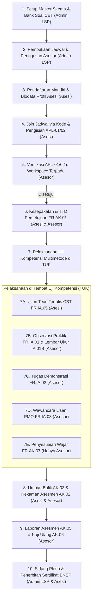

# Alur Pengerjaan Sertifikasi Kompetensi Terpadu (End-to-End Timeline)

> Catatan historis baseline, bukan spesifikasi implementasi aktif. Keputusan owner terbaru dan koreksi atas consent, hasil otomatis, sertifikat, peran serta scope ada di [CONTEXT.md](CONTEXT.md); ikuti [EXECUTION_PLAN.md](EXECUTION_PLAN.md).
**Lembaga Sertifikasi Profesi Praktisi Otomotif Indonesia (LSP PrO Indo)**  
*Dokumen Rujukan Urutan Kejadian Kronologis untuk Pengujian, Operasional Sistem, dan Audit Lisensi BNSP*

---

## Ringkasan Prinsip Alur

Dokumen ini memetakan seluruh urutan kegiatan sertifikasi kompetensi profesi secara **kronologis (urutan 1 sampai 10)** dari awal pembuatan jadwal hingga penerbitan sertifikat resmi BNSP. 

### 3 Aktor Utama:
1. **`ADMIN_LSP` (Administrator LSP):** Mengelola master skema, bank soal CBT, jadwal asesmen, penugasan asesor, dan pengesahan sidang pleno. Admin **tidak ikut** memeriksa berkas permohonan asesi.
2. **`ASESOR` (Asesor Kompetensi):** Memegang kendali teknis asesmen. Meninjau APL-01/02, menyetujui AK-01, mengarahkan pengujian praktik & teori di TUK, mengisi AK-07 bila ada kondisi khusus, merekam hasil akhir AK-02 (K/BK), dan menyusun laporan AK-05/AK-06.
3. **`ASESI` (Peserta Uji):** Mendaftar mandiri via kode jadwal 4 digit, melengkapi profil dan TTD digital sekali, mengisi APL-01/02, menyetujui AK-01 1-klik, mengikuti ujian CBT dan praktik sesuai arahan asesor, serta mengunduh sertifikat resmi.

---

## Kronologi Kejadian (Langkah 1 s/d 10)

---

### Langkah 1: Setup Master Data Skema & Bank Soal CBT
- **Aktor:** Admin LSP
- **Instrumen BNSP:** Standar Kompetensi Kerja Nasional Indonesia (SKKNI), Dokumen Skema Sertifikasi, Bank Soal `FR.IA.05`.
- **Aksi Sistem:**
  1. Admin memastikan skema sertifikasi (7 skema otomotif) aktif di menu `/admin/schemes`.
  2. Memeriksa hierarki Unit Kompetensi, Elemen, dan Kriteria Unjuk Kerja (KUK).
  3. Memastikan bank soal pilihan ganda di `/admin/question-banks` telah terpetakan ke unit kompetensi skema lengkap dengan kunci jawaban dan bobot *passing grade*.
- **Bukti Audit:** Status skema aktif (`m_schemes.is_active = true`), relasi unit dan bank soal valid.

---

### Langkah 2: Pembukaan Jadwal Asesmen & Penugasan Asesor
- **Aktor:** Admin LSP
- **Instrumen BNSP:** Surat Tugas Asesor & Surat Pemberitahuan Jadwal Asesmen.
- **Aksi Sistem:**
  1. Admin membuka menu Jadwal Asesmen (`/admin/jadwal`) dan menekan **+ Tambah Jadwal Baru**.
  2. Mengisi data murni administratif: Memilih Skema Sertifikasi, mengisi Nama TUK dan jenis TUK (Sewaktu / Mandiri / Tempat Kerja), menentukan tanggal & jam pelaksanaan, dan menugaskan Asesor Kompetensi yang berlisensi aktif.
  3. Admin **tidak dibebani pilihan instrumen teknis**; penentuan instrumen uji diserahkan ke ranah kesepakatan Asesor & Asesi di FR.AK.01.
  4. Sistem otomatis menggenerasi **Kode Jadwal 4 Digit** (misal: `7A3K`).
- **Bukti Audit:** Record `t_schedules` berstatus `ACTIVE`, relasi penugasan asesor tersimpan pada `t_schedule_assessors`.

---

### Langkah 3: Pendaftaran Mandiri & Biodata Profil Asesi
- **Aktor:** Asesi (Peserta Uji)
- **Instrumen BNSP:** Buku Registrasi Asesi & Master Biodata Pemohon.
- **Aksi Sistem:**
  1. Asesi mendaftar akun baru melalui antarmuka web.
  2. Asesi membuka menu **Profil Saya** (`/asesi/profile`) untuk melengkapi data wajib: NIK KTP (16 digit), tempat/tanggal lahir, alamat rumah, nomor telepon, dan institusi/sekolah asal.
  3. Asesi membubuhkan **tanda tangan digital canvas** satu kali pada profil akunnya. Tanda tangan ini disimpan aman dan digunakan untuk seluruh dokumen MUK resmi.
- **Bukti Audit:** Record `user_profiles` lengkap dengan NIK valid dan data `signature_data` (base64 PNG).

---

### Langkah 4: Bergabung ke Jadwal & Pengisian Formulir Permohonan FR.APL.01/02
- **Aktor:** Asesi (Peserta Uji)
- **Instrumen BNSP:** 
  - `FR.APL.01`: Formulir Permohonan Sertifikasi Kompetensi (Bagian 1 Data Pribadi, Bagian 2 Data Sertifikasi & Unit, Bagian 3 Bukti Kelengkapan).
  - `FR.APL.02`: Formulir Asesmen Mandiri K/BK.
- **Aksi Sistem:**
  1. Asesi memasukkan Kode Jadwal 4 Digit pada dasbornya untuk bergabung.
  2. Asesi mengisi formulir **FR.APL.01**: memeriksa kesesuaian unit skema dan mengunggah berkas bukti dasar (KTP, pas foto latar merah, ijazah SMK/surat keterangan kerja).
  3. Asesi mengisi **FR.APL.02**: menilai kemampuan mandiri per KUK dengan memilih **Kompeten (K)** atau **Belum Kompeten (BK)** (didukung tombol cepat *"Pilih Semua K"*).
  4. Asesi mengonfirmasi pernyataan kebenaran data dan menekan tombol *"Kirim Permohonan Sertifikasi"*.
- **Transisi Status:** Status APL berubah menjadi `SUBMITTED`. Sistem langsung mengarahkan asesi ke dasbor tanpa redirect berantai.

---

### Langkah 5: Verifikasi Berkas & Seleksi Massal Asesor (Bulk Action)
- **Aktor:** Asesor Kompetensi
- **Instrumen BNSP:** Lembar Verifikasi Kelayakan Permohonan & Asesmen Mandiri VATM.
- **Aksi Sistem:**
  1. Asesor membuka daftar peserta jadwal (`/asesor/jadwal/{id}/asesi`).
  2. **Opsi Cepat di TUK (Seleksi Massal / "Pilih Banyak"):** Asesor dapat mencentang asesi (*Pilih Semua* atau asesi tertentu), lalu menekan tombol **"✓ Setujui APL & Buka Ruang Uji Massal"**. Dalam 1-klik, seluruh berkas asesi disahkan, tanda tangan profil disematkan pada FR.AK.01, FR.AK.07 standar digenerate, dan Ruang Uji langsung dibuka serentak.
  3. **Opsi Per-Kandidat (Workspace Terpadu):** Asesor juga dapat membuka workspace asesi perorangan untuk meninjau detail bukti portofolio dasar, catatan KUK, atau meminta revisi berkas jika dokumen buram.
  4. **Atur Instrumen Uji (Unlock Modul):** Asesor dapat menyesuaikan instrumen MUK aktif per-kandidat (misal: CBT saja, praktik observasi saja, atau seluruh instrumen standar).
- **Bukti Audit:** Kolom `apl_status = 'APPROVED'`, `approved_at = timestamp`, dan `assessor_id` tercatat sah.

---

### Langkah 6: Pengesahan Otomatis Persetujuan Asesmen FR.AK.01
- **Aktor:** Sistem Asesmen, Asesor & Asesi
- **Instrumen BNSP:** `FR.AK.01`: Formulir Persetujuan Asesmen dan Kerahasiaan.
- **Aksi Sistem:**
  1. **Pengesahan Otomatis:** Saat APL disetujui asesor, sistem otomatis menyematkan tanda tangan profil asesi dan tanda tangan profil asesor pada dokumen FR.AK.01 (*dual-signature*).
  2. **Asesi Tanpa Beban Form Tambahan:** Asesi **tidak perlu tanda tangan manual ulang** atau melewati form penghambat. Lembar kesepakatan FR.AK.01 tetap dapat dilihat/diunduh asesi sewaktu-waktu di dasbor.
  3. **Penyesuaian Wajar (FR.AK.07):** Dibuatkan draf standar secara otomatis. Jika ada kondisi darurat/kebutuhan khusus di TUK, asesor dapat mengubahnya 100% mandiri tanpa melibatkan asesi.
- **Bukti Audit:** Kolom `ak01_agreed_at`, `asesi_signature`, dan `assessor_signature` terisi lengkap dan sah.

---

### Langkah 7: Pelaksanaan Uji Kompetensi Multimetode di TUK (Progressive Unlocking)
- **Aktor:** Asesi & Asesor (Diarahkan langsung oleh Asesor di tempat uji)
- **Instrumen BNSP:** Paket MUK Aktif (`FR.IA.05`, `FR.IA.01`, `FR.IA.01B`, `FR.IA.02`, `FR.IA.03`, `FR.AK.07`).
- **Prinsip Tampilan Asesi:** *Progressive Unlocking* — Ruang Uji asesi hanya menampilkan modul/instrumen yang dibuka untuk asesi tersebut. Tidak ada kartu abu-abu bertuliskan "🔒 Terkunci" atau elemen mati yang membingungkan.
- **Aksi Sistem:**
  - **7A. Ujian Teori Tertulis CBT (`FR.IA.05`) [Asesi]:**
    Asesi membuka Ruang Uji dan mengerjakan soal pilihan ganda di komputer/tablet TUK. Sistem menerapkan proteksi ganda: penyimpanan jawaban instan di `localStorage` per klik dan sinkronisasi otomatis (*debounced draft sync*) ke server. Jawaban aman dari risiko refresh halaman atau jaringan terputus. Nilai terhitung otomatis (*auto-grading*) saat ujian diserahkan.
  - **7B. Ceklis Observasi Praktik (`FR.IA.01` & `FR.IA.01B`) [Asesor]:**
    Asesor mengamati demonstrasi unjuk kerja asesi di workshop TUK, menandai pencapaian KUK (K/BK), dan mencatat verifikasi lembar pengukuran teknis (*Report Sheet*).
  - **7C. Tugas Praktik Demonstrasi (`FR.IA.02`) [Asesor]:**
    Asesor mengevaluasi penyelesaian penugasan praktik sesuai standar operasional bengkel.
  - **7D. Wawancara / Pertanyaan Lisan PMO (`FR.IA.03`) [Asesor]:**
    Asesor mengonfirmasi pemahaman teori dan dasar keselamatan kerja melalui pertanyaan lisan terstruktur.
  - **7E. Penyesuaian yang Wajar dan Beralasan (`FR.AK.07`) [Asesor 100%]:**
    Formulir ini diisi *eksklusif oleh Asesor* bila ada kandidat berkebutuhan khusus atau kondisi darurat TUK (misal: listrik padam sehingga waktu ditambah). Asesi **tidak pernah** diminta mengisi form ini.
- **Bukti Audit:** Jawaban CBT tersimpan di `t_assessment_ia_responses` (kode `IA05`), hasil observasi praktik dan lembar penilaian tercatat di sistem.
    Asesi membuka Ruang Uji dan mengerjakan soal pilihan ganda di komputer/tablet TUK. Sistem menerapkan proteksi ganda: penyimpanan jawaban instan di `localStorage` per klik dan sinkronisasi otomatis (*debounced draft sync*) ke server. Jawaban aman dari risiko refresh halaman atau jaringan terputus. Nilai terhitung otomatis (*auto-grading*) saat ujian diserahkan.
  - **7B. Ceklis Observasi Praktik (`FR.IA.01` & `FR.IA.01B`) [Asesor]:**
    Asesor mengamati demonstrasi unjuk kerja asesi di workshop TUK, menandai pencapaian KUK (K/BK), dan mencatat verifikasi lembar pengukuran teknis (*Report Sheet*).
  - **7C. Tugas Praktik Demonstrasi (`FR.IA.02`) [Asesor]:**
    Asesor mengevaluasi penyelesaian penugasan praktik sesuai standar operasional bengkel.
  - **7D. Wawancara / Pertanyaan Lisan PMO (`FR.IA.03`) [Asesor]:**
    Asesor mengonfirmasi pemahaman teori dan dasar keselamatan kerja melalui pertanyaan lisan terstruktur.
  - **7E. Penyesuaian yang Wajar dan Beralasan (`FR.AK.07`) [Asesor 100%]:**
    Formulir ini diisi *eksklusif oleh Asesor* bila ada kandidat berkebutuhan khusus atau kondisi darurat TUK (misal: listrik padam sehingga waktu ditambah). Asesi **tidak pernah** diminta mengisi form ini.
- **Bukti Audit:** Jawaban CBT tersimpan di `t_assessment_ia_responses` (kode `IA05`), hasil observasi praktik dan lembar penilaian tercatat di sistem.

---

### Langkah 8: Umpan Balik Asesi & Rekaman Rekomendasi Asesmen FR.AK.02
- **Aktor:** Asesi & Asesor
- **Instrumen BNSP:**
  - `FR.AK.03`: Formulir Umpan Balik dan Catatan Asesmen (10 butir pertanyaan evaluasi).
  - `FR.AK.04`: Formulir Banding Asesmen (Hak asesi bila hasil BK).
  - `FR.AK.02`: Formulir Rekaman Asesmen Kompetensi.
- **Aksi Sistem:**
  1. **Asesi:** Membuka modul FR.AK.03 pada dasbor untuk memberikan penilaian terhadap jalannya asesmen (Ya/Tidak dan komentar konstruktif).
  2. **Asesor:** Membuka **Tab 5 Workspace (FR.AK.02 Rekaman Asesmen)**. Memeriksa matriks Unit Kompetensi vs Metode Pengumpulan Bukti (Observasi, Portofolio, Lisan, Tertulis), memanfaatkan tombol cepat *"Semua K"* atau *"Semua BK"*, menentukan rekomendasi akhir (**KOMPETEN** atau **BELUM KOMPETEN**), mengisi usulan tindak lanjut, dan menyimpan rekaman asesmen.
  3. **Hak Banding (Bila BK):** Jika asesi dinyatakan Belum Kompeten, tombol pengajuan banding (FR.AK.04) aktif di dasbor asesi untuk mengajukan peninjauan ulang bila dinilai ada ketidaksesuaian prosedur.
- **Bukti Audit:** Record `t_assessment_ak02_items` terisi per unit kompetensi, `final_result` (`KOMPETEN` / `BELUM_KOMPETEN`), dan umpan balik `t_assessment_ak03_items` tersimpan.

---

### Langkah 9: Laporan Asesmen FR.AK.05 & Kaji Ulang Jadwal FR.AK.06
- **Aktor:** Asesor Kompetensi (Lead Assessor)
- **Instrumen BNSP:**
  - `FR.AK.05`: Laporan Asesmen (Distribusi hasil uji dan evaluasi TUK).
  - `FR.AK.06`: Meninjau Proses Asesmen (Verifikasi 4 Prinsip: Valid, Reliabel, Fleksibel, Adil).
- **Aksi Sistem:**
  1. Setelah seluruh peserta pada jadwal selesai dinilai, Asesor membuka menu **Laporan & Tutup Jadwal** (`/asesor/schedule/{id}/reports`).
  2. Mengisi evaluasi FR.AK.05: aspek positif TUK, kendala teknis lapangan, dan rekomendasi peningkatan mutu.
  3. Mengisi verifikasi FR.AK.06: kesesuaian prinsip validitas, reliabilitas, fleksibilitas, keadilan, serta catatan peninjau proses.
  4. Mencentang konfirmasi integritas peninjauan draf dan menekan tombol *"Simpan Laporan & Tutup Jadwal Asesmen (Final)"*.
  5. Jadwal resmi dikunci dan ditutup (`is_closed = true`, status `FINISHED`). Seluruh nilai peserta terkunci demi integritas audit.
- **Bukti Audit:** JSON data `ak05_report` dan `ak06_review` tersimpan pada `t_schedules`, kolom `is_closed = 1`.

---

### Langkah 10: Pengesahan Sidang Pleno & Penerbitan Sertifikat Digital BNSP
- **Aktor:** Admin LSP & Asesi
- **Instrumen BNSP:** Berita Acara Sidang Pleno, Presensi Sidang Pleno, dan Sertifikat Kompetensi Resmi BNSP.
- **Aksi Sistem:**
  1. **Admin LSP:** Membuka menu **Sidang Pleno** (`/admin/pleno`), memilih jadwal yang telah berstatus `FINISHED`, memverifikasi daftar rekomendasi kelulusan asesor, mengisi data berita acara (Nomor BA, tanggal pleno, lokasi, dan ketua pengesah), lalu menekan *"Sahkan Keputusan Pleno"*.
  2. Sistem secara otomatis menerbitkan **Nomor Sertifikat Resmi BNSP** (misal: `BNSP-2026-00012`) dengan masa berlaku lisensi standar 3 tahun.
  3. Admin dapat mengunduh Berita Acara Pleno dan Presensi Pleno berformat PDF resmi.
  4. **Asesi:** Di dasbor asesi, kartu Modul 5 menampilkan status *"Sertifikat Terbit"* dengan Nomor Sertifikat BNSP resmi, dan tombol **Unduh Sertifikat BNSP** aktif untuk mengunduh dokumen sertifikat digital berbingkai resmi BNSP.
- **Bukti Audit:** Record `pleno_meetings` berstatus `disahkan`, kolom `no_sertifikat`, `tgl_terbit_sertifikat`, dan `masa_berlaku_sertifikat` terisi di database.
