# Alur Kronologis Pengerjaan Sertifikasi Kompetensi (End-to-End Audit Trail)
**LSP Praktisi Otomotif Indonesia (LSP PrO Indo 2.0)**  
*Dokumen Panduan Urutan Kejadian Tunggal Terpadu untuk Kebutuhan Demonstrasi, QA Testing, dan Audit Lisensi BNSP*

---

## Ringkasan Eksekutif & Prinsip Alur

Dokumen ini disusun secara **kronologis berurutan (*chronological timeline*)** dari awal mula persiapan hingga penerbitan sertifikat dan surveilans, **bukan dipisah per peran (*role*)**, melainkan menggambarkan interaksi antar-aktor (*Asesi, Admin LSP, Verifikator, Asesor, Admin TUK, dan Komite Teknis*) dalam satu garis waktu kejadian nyata.

Setiap tahapan memuat 6 atribut audit esensial:
1. **Urutan Kejadian & Nama Tahap**
2. **Aktor Utama & Kolaborator** (Siapa yang mengeksekusi dan siapa yang merespons)
3. **Instrumen / Dokumen Standar BNSP** (Formulir MUK yang diisi/dihasilkan)
4. **Antarmuka & Rute Sistem** (URL halaman web, tombol aksi yang ditekan)
5. **Transisi Status Data (*State Machine*)** (Perubahan status di database)
6. **Titik Pemeriksaan Audit (*Audit Evidence / Audit Trail*)** (Bukti yang dicari auditor: log waktu, digital signature, IP, file upload, nilai skor)

---

## Diagram Alur Kejadian Terpadu (Chronological Timeline)

```mermaid
flowchart TD
    %% TAHAP PERSIAPAN
    T1["Tahap 1: Setup Master Skema & Bank Soal CBT (Admin LSP)"] --> T2["Tahap 2: Verifikasi Kesiapan TUK (Admin TUK & Tim Verifikator)"]
    T2 --> T3["Tahap 3: Pembukaan Jadwal & Plotting Asesor (Admin LSP)"]
    
    %% TAHAP PENDAFTARAN
    T3 --> T4["Tahap 4: Registrasi Akun Asesi & Gores TTD Digital (Asesi)"]
    T4 --> T5["Tahap 5: Join Jadwal & Pengisian Portofolio FR.APL.01 (Asesi)"]
    T5 --> T6{"Tahap 6: Verifikasi Berkas Administrasi APL-01 (Admin LSP)"}
    
    T6 -- "Perlu Perbaikan" --> T5
    T6 -- "Memenuhi Syarat" --> T7["Tahap 7: Pengisian Asesmen Mandiri FR.APL.02 (Asesi)"]
    
    %% TAHAP PRA-ASESMEN
    T7 --> T8{"Tahap 8: Review Bukti & Rekomendasi Pra-Asesmen (Asesor)"}
    T8 -- "Bukti Belum Lengkap" --> T7
    T8 -- "Lanjut Asesmen" --> T9["Tahap 9: Perencanaan Asesmen FR.MAPA.01 (Asesor)"]
    
    %% TAHAP PELAKSANAAN UJI
    T9 --> T10["Tahap 10: Persetujuan Kerahasiaan FR.AK.01 (Asesi & Asesor)"]
    T10 --> T11["Tahap 11: Pelaksanaan Uji Kompetensi Multimetode"]
    
    subgraph UjiMultimetode["Pelaksanaan Ujian di Ruang Uji"]
        T11A["11A. Teori CBT FR.IA.05 (Auto-Grading)"]
        T11B["11B. Uji Praktik / Demonstrasi FR.IA.02"]
        T11C["11C. Ceklis Observasi Praktik FR.IA.01"]
        T11D["11D. Wawancara / Lisan FR.IA.03"]
    end
    T11 --> UjiMultimetode
    UjiMultimetode --> T12["Tahap 12: Pengisian Umpan Balik Asesi FR.AK.03 (Asesi)"]
    
    %% TAHAP KEPUTUSAN & LAPORAN
    T12 --> T13["Tahap 13: Rekaman Asesmen FR.AK.02 & Rekomendasi K/BK (Asesor)"]
    T13 --> T14["Tahap 14: Laporan Asesmen FR.AK.05 & Validasi Mutu MKVA (Asesor)"]
    T14 --> T15{"Tahap 15: Sidang Pleno Komite Teknis LSP (Komite Teknis)"}
    
    %% PENETAPAN FINAL
    T15 -- "Disetujui (Approved)" --> T16["Tahap 16: Penerbitan Sertifikat Garuda BNSP (Admin LSP)"]
    T15 -- "Ada Sanggahan" --> T17["Tahap 17: Penanganan Banding Asesmen FR.AK.04 (Tim Banding)"]
    T16 --> T18["Tahap 18: Surveilans & Pemeliharaan Sertifikat (Admin LSP)"]
```



---

## Rincian Kronologis Tahap demi Tahap (1 s/d 18)

### Tahap 1: Setup Master Skema & Bank Soal CBT
* **Urutan Waktu**: Hari H-30 (Pra-Kegiatan).
* **Aktor Utama**: Admin LSP / Bagian Standarisasi Mutu.
* **Instrumen BNSP**: Dokumen Skema Sertifikasi KKNI/Klaster & Bank Soal Pilihan Ganda (`FR.IA.05`).
* **Alur di Sistem**:
  1. Admin membuka menu **Master Skema Sertifikasi** (`/admin/schemes`).
  2. Mengisi parameter skema: Kode Skema, Judul Skema, Kategori (Otomotif), Jenis Standar (SKKNI), dan *Passing Grade Theory* (75.00%).
  3. Memasukkan Unit Kompetensi, Elemen Kompetensi, dan butir KUK via antarmuka CRUD hierarki skema (`/admin/schemes/{id}`).
  4. Membuka menu **Bank Soal CBT (IA05)** (`/admin/question-banks`) untuk memastikan paket butir soal CBT terpetakan ke unit kompetensi skema (total 330 butir soal pilihan ganda terdaftar).
* **Transisi Status Sistem**:
  - `m_schemes.is_active` = `true`
  - `m_question_banks.scheme_id` terhubung ke skema terkait.
* **Titik Pemeriksaan Audit (*Audit Evidence*)**:
  - Struktur data skema sesuai surat ketetapan skema BNSP.
  - Jumlah butir soal mencukupi seluruh unit kompetensi skema.

---

### Tahap 2: Verifikasi Kesiapan TUK & Fasilitas Uji
* **Urutan Waktu**: Hari H-14.
* **Aktor Utama**: Admin Tempat Uji Kompetensi (TUK) & Tim Verifikator Sarana Prasarana.
* **Instrumen BNSP**: Formulir Verifikasi Kelayakan TUK (Sewaktu / Mandiri / Tempat Kerja).
* **Alur di Sistem**:
  1. Admin mengelola Master TUK di menu **Master TUK** (`/admin/tuks`).
  2. Tim verifikator membuka menu **Verifikasi Kelayakan TUK** (`/admin/tuk-verifications`).
  3. Mengisi ceklis kelayakan alat bengkel uji (misal: Diagnostic Tools, multimeter, SST kopling, gas analyzer, APAR, dan layout K3).
  4. Menyetujui status kelayakan TUK.
* **Transisi Status Sistem**:
  - `m_tuks.is_active` = `true`
  - `tuk_verifications.status` = `APPROVED`
* **Titik Pemeriksaan Audit (*Audit Evidence*)**:
  - Berita Acara Verifikasi TUK tersimpan lengkap dengan foto sarana dan nama verifikator.

---

### Tahap 3: Pembukaan Jadwal Asesmen & Plotting Asesor
* **Urutan Waktu**: Hari H-7.
* **Aktor Utama**: Admin LSP.
* **Instrumen BNSP**: Surat Tugas Asesor & Surat Pemberitahuan Jadwal Asesmen.
* **Alur di Sistem**:
  1. Admin membuka menu **Jadwal Asesmen** (`/admin/schedules`).
  2. Menekan tombol **+ Tambah Jadwal Baru**.
  3. Memilih Skema Sertifikasi, Lokasi TUK, Tanggal Pelaksanaan, Kuota Peserta, dan menugaskan Asesor Kompetensi berlisensi (memiliki No MET).
  4. Sistem otomatis menggenerasi **Kode Jadwal Unik** (misal: `EVT-2026-001` atau kode acak akses asesi).
* **Transisi Status Sistem**:
  - `t_schedules.status` = `OPEN`
  - Relasi `t_schedule_assessors` mencatat relasi jadwal dengan ID Asesor yang ditugaskan.
* **Titik Pemeriksaan Audit (*Audit Evidence*)**:
  - Rasio asesor terhadap asesi (maksimal 1:10 untuk observasi praktik).
  - Masa berlaku sertifikat kompetensi asesor teknis dan No. MET masih aktif.

---

### Tahap 4: Registrasi Akun Asesi & Penyiapan TTD Digital
* **Urutan Waktu**: Hari H-5.
* **Aktor Utama**: Calon Peserta Asesi.
* **Instrumen BNSP**: Data Pribadi Asesi & Spesimen Tanda Tangan Asesi.
* **Alur di Sistem**:
  1. Calon asesi membuka portal `/login` & memilih **Daftar Akun Baru**.
  2. Login ke sistem, masuk ke **Dashboard Asesi** (`/asesi/dashboard`).
  3. Membuka menu **Profil & Akun** (`/asesi/profile`).
  4. Melengkapi data diri: NIK KTP (16 digit), Tempat/Tgl Lahir, Jenis Kelamin, Kebangsaan, Alamat Domisili, No HP WhatsApp, Nama Lembaga/Perusahaan, dan Jenjang Pendidikan.
  5. **Goresan Tanda Tangan Digital**: Asesi menggambar tanda tangan di atas kanvas HTML5 (cukup dilakukan 1 kali) dan klik simpan. Sistem menyimpannya sebagai data PNG Base64 yang siap diinjeksi ke 24 berkas MUK.
* **Transisi Status Sistem**:
  - `users.role` = `ASESI`
  - `m_user_profiles.signature_image` = string base64 tanda tangan.
* **Titik Pemeriksaan Audit (*Audit Evidence*)**:
  - Validitas format NIK dan data kontak aktif.
  - Adanya *consent* e-signature tersimpan dengan stempel waktu (`signed_at`).

---

### Tahap 5: Pendaftaran ke Jadwal & Pengisian Portofolio FR.APL.01
* **Urutan Waktu**: Hari H-4.
* **Aktor Utama**: Asesi.
* **Instrumen BNSP**: `FR.APL.01. Permohonan Sertifikasi Kompetensi`.
* **Alur di Sistem**:
  1. Di dasbor asesi, asesi memasukkan Kode Jadwal di kartu **Gabung Jadwal Uji**.
  2. Sistem membuka formulir terpadu **FR.APL.01** (`/asesi/apl01/{schedule}`).
  3. Asesi memilih tujuan asesmen: *Sertifikasi Baru*, *Sertifikasi Ulang*, atau *Pengakuan Kompetensi Terkini (PKT)*.
  4. Mengunggah berkas bukti dasar kelayakan (KTP, Ijazah Terakhir, Surat Pengalaman Kerja / Pelatihan Otomotif).
  5. Menekan tombol **Ajukan Permohonan Sertifikasi**.
* **Transisi Status Sistem**:
  - `assessment_applications.status` = `diajukan` (Menunggu Verifikasi)
  - `t_assessments.apl_status` = `SUBMITTED`
* **Titik Pemeriksaan Audit (*Audit Evidence*)**:
  - Dokumen persyaratan PDF/JPG terunggah dan dapat diunduh oleh verifikator.
  - Berkas APL-01 berisikan rincian data pemohon yang terhubung dengan NIK.

---

### Tahap 6: Verifikasi Berkas Administrasi APL-01
* **Urutan Waktu**: Hari H-3.
* **Aktor Utama**: Admin LSP / Tim Verifikasi Berkas.
* **Instrumen BNSP**: Rekomendasi Kelayakan Administrasi Pemohon (Bagian 3 FR.APL.01).
* **Alur di Sistem**:
  1. Admin membuka menu **Verifikasi Berkas APL** (`/admin/verifications`).
  2. Membuka detail berkas asesi (`/admin/verifications/{id}`).
  3. Memeriksa keabsahan KTP, kesesuaian ijazah/sertifikat pelatihan dengan persyaratan skema.
  4. Melakukan aksi:
     - Jika tidak sesuai: Klik **Minta Revisi** (menulis catatan perbaikan yang muncul di asesi).
     - Jika lengkap: Klik **Terima & Verifikasi Berkas**.
* **Transisi Status Sistem**:
  - `assessment_applications.status` = `diterima`
  - `t_assessments.admin_status` = `APPROVED`
  - `t_assessments.admin_approved_at` = stempel waktu verifikasi.
* **Titik Pemeriksaan Audit (*Audit Evidence*)**:
  - User ID verifikator tercatat sebagai `admin_reviewer_id`.
  - Berkas status `diterima` menjadi syarat mutlak dibukanya asesmen mandiri.

---

### Tahap 7: Pengisian Asesmen Mandiri FR.APL.02
* **Urutan Waktu**: Hari H-2.
* **Aktor Utama**: Asesi.
* **Instrumen BNSP**: `FR.APL.02. Asesmen Mandiri`.
* **Alur di Sistem**:
  1. Setelah APL-01 diterima, tombol **Isi Asesmen Mandiri (APL-02)** aktif di dasbor asesi (`/asesi/apl02/{schedule}`).
  2. Sistem menyajikan seluruh Unit Kompetensi beserta seluruh butir KUK skema terkait.
  3. Untuk setiap butir KUK, asesi mencentang:
     - **K (Kompeten)**: Jika merasa telah menguasai kriteria tersebut.
     - **BK (Belum Kompeten)**: Jika belum menguasai.
  4. Mengaitkan bukti relevan (misal: *Sertifikat PKL Bengkel*, *Logbook Servis*, *Job Sheet Praktik*).
  5. Menekan tombol **Kirim Asesmen Mandiri**.
* **Transisi Status Sistem**:
  - Data tersimpan pada tabel `t_assessment_apl02_items` (koleksi KUK, opsi K/BK, tautan bukti).
  - `t_assessments.apl_status` = `APL02_SUBMITTED`
* **Titik Pemeriksaan Audit (*Audit Evidence*)**:
  - Seluruh butir KUK wajib terisi lengkap (tidak boleh ada KUK yang terlewati).
  - Tanda tangan asesi tersemat pada lembar APL-02 digital.

---

### Tahap 8: Review Bukti & Rekomendasi Pra-Asesmen oleh Asesor
* **Urutan Waktu**: Hari H-1.
* **Aktor Utama**: Asesor Kompetensi yang ditugaskan.
* **Instrumen BNSP**: Rekomendasi Asesor Pra-Asesmen pada Lembar FR.APL.02.
* **Alur di Sistem**:
  1. Asesor login ke portal sistem (`/asesor/dashboard`).
  2. Membuka menu **Jadwal Asesmen** & memilih jadwal aktif.
  3. Klik menu **Verifikasi APL Peserta** (`/asesor/verifikasi-apl/{application}`).
  4. Asesor memeriksa klaim K/BK asesi dan memvalidasi keabsahan bukti portofolio yang diunggah.
  5. Asesor memberikan keputusan pra-asesmen:
     - Memberikan centang verifikasi asesor (*V*).
     - Menetapkan rekomendasi: **"Dapat dilanjutkan ke proses uji kompetensi"** atau **"Belum dapat dilanjutkan / perlu perbaikan bukti"**.
  6. Menekan tombol **Simpan Verifikasi Pra-Asesmen**.
* **Transisi Status Sistem**:
  - `t_assessments.apl_status` = `APPROVED`
  - `t_assessments.status` = `READY_FOR_ASSESSMENT`
  - `t_assessments.assessor_id` = ID Asesor pemeriksa.
* **Titik Pemeriksaan Audit (*Audit Evidence*)**:
  - Waktu telaah asesor tercatat sebelum pelaksanaan uji fisik dimulai.
  - Rekomendasi asesor ditandatangani secara digital dengan stempel No. MET Asesor.

---

### Tahap 9: Perencanaan Aktivitas & Proses Asesmen FR.MAPA.01
* **Urutan Waktu**: Hari H-1 s/d Hari H (Pagi sebelum uji).
* **Aktor Utama**: Asesor Kompetensi.
* **Instrumen BNSP**: `FR.MAPA.01. Merencanakan Aktivitas dan Proses Asesmen`.
* **Alur di Sistem**:
  1. Asesor membuka modul instrumen jadwal terkait (`/admin/dokumen-muk/{schedule}`).
  2. Meninjau Matriks Pemetaan Bukti: Menetapkan instrumen yang digunakan:
     - Uji Teori Tertulis (`FR.IA.05`)
     - Ceklis Observasi Praktik (`FR.IA.01`)
     - Tugas Praktik Demonstrasi (`FR.IA.02`)
     - Pertanyaan Lisan Mendukung Observasi (`FR.IA.03`)
* **Transisi Status Sistem**:
  - Konfigurasi perangkat uji pada jadwal terkunci (*locked for testing*).
* **Titik Pemeriksaan Audit (*Audit Evidence*)**:
  - Form MAPA-01 terbit dan memetakan bukti langsung, bukti tidak langsung, dan bukti tambahan.

---

### Tahap 10: Persetujuan Asesmen & Kerahasiaan FR.AK.01
* **Urutan Waktu**: Hari H (Pukul 08.00 - Briefing Pra-Uji).
* **Aktor Utama**: Asesi dan Asesor Kompetensi.
* **Instrumen BNSP**: `FR.AK.01. Persetujuan Asesmen dan Kerahasiaan`.
* **Alur di Sistem**:
  1. Asesor dan Asesi berkumpul di TUK.
  2. Asesi masuk ke **Ruang Uji Digital** (`/asesi/ruang-uji/{assessment}`).
  3. Layar pertama menampilkan dokumen **Persetujuan Asesmen**:
     - Penjelasan mengenai tujuan asesmen, ruang lingkup skema, dan hak mengajukan banding.
     - Klausul kerahasiaan materi uji kompetensi.
  4. Asesi mencentang persetujuan: *"Saya telah membaca dan menyetujui seluruh ketentuan asesmen ini"* dan klik **Kirim Persetujuan (AK.01)**.
  5. Asesor memverifikasi di konsol asesor (`/asesor/ruang-uji/{assessment}`).
* **Transisi Status Sistem**:
  - `t_assessments.ak01_agreed_at` = waktu persetujuan live.
  - `t_assessments.status` = `IN_PROGRESS`
* **Titik Pemeriksaan Audit (*Audit Evidence*)**:
  - Timestamp `ak01_agreed_at` mendahului waktu ujian pertama (bukti tidak ada uji coba ilegal sebelum asesi setuju).

---

### Tahap 11: Pelaksanaan Uji Kompetensi Multimetode

Pelaksanaan asesmen di ruang uji berlangsung terintegrasi dengan 4 instrumen pengujian:

#### 11A. Uji Teori Tertulis Berbasis Komputer (CBT FR.IA.05)
* **Pelaku**: Asesi (Mengerjakan) & Sistem (Auto-Grading).
* **Alur**:
  - Asesi mengerjakan soal pilihan ganda di modul CBT (`/asesi/ruang-uji/{assessment}`).
  - Pilihan opsi A, B, C, D dengan antarmuka ujian modern dan pengatur waktu (*timer*).
  - Saat klik **Selesaikan Ujian Teori**, sistem secara otomatis mencocokkan jawaban dengan kunci di database `m_question_banks` (*Auto-Grade Service*).
  - Skor teori langsung dihitung (misal: 85.00%). Status kelulusan teori dinilai berdasarkan passing grade skema (75.00%).
* **Bukti Audit**: Rekaman log jawaban asesi, persentase nilai akhir, dan status kelulusan teori otomatis tersimpan di tabel `t_assessments.theory_score`.

#### 11B. Uji Praktik / Demonstrasi Kerja (FR.IA.02)
* **Pelaku**: Asesi (Mendemonstrasikan) & Asesor (Mengamati di Bengkel TUK).
* **Alur**:
  - Asesi melakukan demonstrasi kerja di workshop/bengkel uji sesuai lembar instruksi kerja `FR.IA.02` (misal: *Bongkar pasang cover body*, *Penggunaan scanner injeksi*, *Penyetelan renggang klep*).
  - Memperhatikan standar K3 dan penggunaan APD.

#### 11C. Ceklis Observasi Aktivitas Praktik (FR.IA.01)
* **Pelaku**: Asesor Kompetensi.
* **Alur**:
  - Asesor memegang gawai/laptop di konsol asesor (`/asesor/ruang-uji/{assessment}`).
  - Membuka lembar observasi `FR.IA.01`.
  - Mengamati setiap butir KUK teknis yang dipraktikkan asesi dan mencentang status pencapaian: **Kompeten (K)** atau **Belum Kompeten (BK)**.
  - Memberikan catatan penilaian unjuk kerja langsung di sistem.
* **Bukti Audit**: Butir centang KUK observasi tersimpan di tabel `t_assessment_ia_responses`.

#### 11D. Pertanyaan Lisan Mendukung Observasi (PMO FR.IA.03)
* **Pelaku**: Asesor (Bertanya) & Asesi (Menjawab Lisan).
* **Alur**:
  - Asesor mengajukan pertanyaan konfirmasi untuk aspek pengetahuan di balik tindakan praktik (misal: *"Mengapa posisi top kompresi harus dipastikan sebelum menyetel celah klep?"*).
  - Asesor mencatat ringkasan tanggapan asesi dan memberikan penilaian pencapaian K / BK.

---

### Tahap 12: Pengisian Umpan Balik Asesmen FR.AK.03
* **Urutan Waktu**: Hari H (Sesaat setelah pengujian teknis selesai).
* **Aktor Utama**: Asesi.
* **Instrumen BNSP**: `FR.AK.03. Umpan Balik dan Catatan Asesmen`.
* **Alur di Sistem**:
  1. Asesi masuk ke halaman umpan balik (`/asesi/ruang-uji/{assessment}/feedback`).
  2. Memberikan evaluasi mandiri berupa centang YA/TIDAK pada komponen:
     - Kejelasan penjelasan asesor sebelum asesmen.
     - Kesesuaian fasilitas dan alat di TUK.
     - Keadilan dan objektivitas asesor selama proses uji.
  3. Menuliskan catatan/masukan perbaikan dan menekan tombol **Kirim Umpan Balik**.
* **Transisi Status Sistem**:
  - Data tersimpan pada tabel `ak03_feedbacks` dan `t_assessment_ak03_items`.
* **Titik Pemeriksaan Audit (*Audit Evidence*)**:
  - Komentar asesi tersimpan independen tanpa bisa diubah oleh asesor (bukti perlindungan hak asesi).

---

### Tahap 13: Penyusunan Rekaman Asesmen FR.AK.02 & Rekomendasi Final Asesor
* **Urutan Waktu**: Hari H (Sore hari setelah seluruh instrumen rampung).
* **Aktor Utama**: Asesor Kompetensi.
* **Instrumen BNSP**: `FR.AK.02. Rekaman Asesmen Kompetensi`.
* **Alur di Sistem**:
  1. Asesor membuka tab **Rekomendasi Final & Rekaman Asesmen** (`/asesor/ruang-uji/{assessment}`).
  2. Sistem menampilkan rekapitulasi nilai:
     - Hasil Uji Teori CBT (FR.IA.05)
     - Hasil Observasi Praktik (FR.IA.01 & IA.02)
     - Hasil Pertanyaan Lisan (FR.IA.03)
  3. Asesor menuliskan catatan ringkasan bukti asesmen.
  4. Menetapkan Rekomendasi Keputusan Asesor:
     - **KOMPETEN (K)**: Apabila seluruh butir KUK terpenuhi dan skor teori mencapai passing grade.
     - **BELUM KOMPETEN (BK)**: Apabila ada butir kritis yang belum tercapai.
  5. Menuliskan rencana tindak lanjut (misal: rekomendasi penerbitan sertifikat bagi K, atau asesmen ulang di unit tertentu bagi BK).
  6. Menekan tombol **Finalisasi Rekomendasi Asesmen**.
* **Transisi Status Sistem**:
  - `t_assessments.status` = `COMPLETED`
  - `t_assessments.final_result` = `KOMPETEN` / `BELUM_KOMPETEN`
  - `t_assessments.completed_at` = stempel waktu finalisasi.
* **Titik Pemeriksaan Audit (*Audit Evidence*)**:
  - Rekomendasi asesor terkunci permanen (*immutable*).
  - Tanda tangan asesor dan No. MET terstempel resmi di lembar FR.AK.02.

---

### Tahap 14: Laporan Asesmen FR.AK.05 & Tinjauan Mutu MKVA
* **Urutan Waktu**: Hari H+1.
* **Aktor Utama**: Asesor Kompetensi & Tim Validasi Mutu (MKVA).
* **Instrumen BNSP**: `FR.AK.05. Laporan Asesmen` & `FR.VA. Tinjauan Mutu Asesmen`.
* **Alur di Sistem**:
  1. Asesor mengunduh/mencetak Berkas Rekapitulasi Pelaksanaan Asesmen.
  2. Tim Mutu / Lead Asesor melakukan sampling verifikasi instrumen uji untuk menjaga konsistensi pengambilan keputusan antar-asesor.
* **Transisi Status Sistem**:
  - Dokumen asesmen siap disidangkan di Rapat Pleno.
* **Titik Pemeriksaan Audit (*Audit Evidence*)**:
  - Berkas laporan asesmen lengkap memuat daftar hadir asesi, daftar hadir asesor, dan rekapitulasi K/BK.

---

### Tahap 15: Sidang / Rapat Pleno Komite Teknis LSP
* **Urutan Waktu**: Hari H+2 s/d H+3.
* **Aktor Utama**: Ketua Komite Teknis / Anggota Komite Teknis & Direktur LSP.
* **Instrumen BNSP**: Berita Acara Rapat Pleno Penetapan Kelulusan Sertifikasi.
* **Alur di Sistem**:
  1. Pimpinan Komite Teknis membuka menu **Rapat Pleno Komite** (`/admin/pleno`).
  2. Sistem menampilkan daftar jadwal asesmen yang statusnya telah diselesaikan oleh asesor (`COMPLETED`).
  3. Komite Teknis mengkaji:
     - Kesesuaian jumlah asesi yang direkomendasikan K dan BK.
     - Integritas berita acara dan bukti pendukung.
  4. Menuliskan catatan sidang pleno dan nomor berita acara pleno.
  5. Menekan tombol **Ketuk Palu / Tetapkan Keputusan Pleno (Approve)**.
* **Transisi Status Sistem**:
  - `pleno_meetings.status` = `APPROVED`
  - `t_assessments.pleno_decision` = `KOMPETEN` / `BELUM_KOMPETEN`
  - `t_assessments.pleno_approved_at` = stempel waktu pengesahan ketua pleno.
* **Titik Pemeriksaan Audit (*Audit Evidence*)**:
  - Berita Acara Pleno berisikan tanda tangan Ketua Komite Teknis dan nomor keputusan resmi (syarat utama BNSP untuk menerbitkan blangko sertifikat).

---

### Tahap 16: Penerbitan Sertifikat Kompetensi BNSP & Pengelolaan Blangko
* **Urutan Waktu**: Hari H+7.
* **Aktor Utama**: Admin LSP / Bagian Sertifikasi.
* **Instrumen BNSP**: Sertifikat Kompetensi Berlogo Garuda Pancasila BNSP.
* **Alur di Sistem**:
  1. Admin membuka menu cetak dokumen (`/admin/dokumen-muk/{schedule}`).
  2. Sistem mengaktifkan pencetakan **Sertifikat Kompetensi Digital** untuk asesi yang diputuskan KOMPETEN pada sidang pleno.
  3. Sistem mengisi metadata sertifikat:
     - Nomor Registrasi Sertifikat BNSP
     - Nomor Seri Blangko Resmi
     - Daftar Unit Kompetensi di balik halaman sertifikat
     - QR Code verifikasi keabsahan sertifikat online.
  4. Asesi dapat melihat nomor sertifikat dan mengunduh surat keterangan kompetensi dari dasbor asesi (`/asesi/dashboard`).
* **Transisi Status Sistem**:
  - `assessment_applications.status_kelulusan` = `LULUS`
  - Masa berlaku sertifikat disetel: 3 Tahun sejak tanggal penetapan pleno.
* **Titik Pemeriksaan Audit (*Audit Evidence*)**:
  - Rekon data nomor sertifikat tersinkron dengan Sistem Informasi BNSP.
  - Generator ekspor Excel data asesi siap kirim (`/admin/exports/{schedule}/excel`).

---

### Tahap 17: Penanganan Banding Asesmen FR.AK.04 (Jalur Khusus / Sanggahan)
* **Urutan Waktu**: Maksimal H+3 hari kerja setelah penetapan hasil.
* **Aktor Utama**: Asesi Pemohon Banding, Admin LSP, dan Tim Banding Independen.
* **Instrumen BNSP**: `FR.AK.04. Banding Asesmen`.
* **Alur di Sistem**:
  1. Jika asesi tidak puas dengan rekomendasi asesor, asesi membuka menu **Pengajuan Banding** di dasbor asesi.
  2. Mengisi formulir banding: Alasan sanggahan, butir KUK yang disanggah, dan bukti pendukung baru.
  3. Admin LSP memantau di menu **Banding Asesmen** (`/admin/appeals`).
  4. Direktur LSP membentuk Tim Banding Independen untuk menginvestigasi rekaman asesmen.
  5. Keputusan banding:
     - Banding ditolak (rekomendasi asesor tetap berlaku).
     - Banding diterima (dilakukan asesmen ulang dengan asesor berbeda).
* **Transisi Status Sistem**:
  - `assessment_appeals.status` = `RESOLVED`
* **Titik Pemeriksaan Audit (*Audit Evidence*)**:
  - Transparansi dan kepatuhan waktu penanganan banding sesuai SLA sistem (maksimal 3 hari kerja).

---

### Tahap 18: Surveilans & Pemeliharaan Kompetensi Berkala
* **Urutan Waktu**: Bulan ke-12 dan Bulan ke-24 pasca-sertifikasi.
* **Aktor Utama**: Admin LSP & Asesi Pemegang Sertifikat.
* **Instrumen BNSP**: Lembar Surveilans Pemegang Sertifikat Kompetensi.
* **Alur di Sistem**:
  1. Admin membuka menu **Surveilans Pemegang Sertifikat** (`/admin/surveillance`).
  2. Sistem mengirimkan pengingat otomatis kepada pemegang sertifikat yang telah mencapai masa 1 atau 2 tahun.
  3. Asesi mengunggah bukti pemeliharaan kompetensi (misal: surat keterangan masih aktif bekerja sebagai mekanik di bengkel resmi, atau sertifikat *upskilling* otomotif terbaru).
  4. Admin memverifikasi keabsahan bukti kerja asesi.
* **Transisi Status Sistem**:
  - `surveillance_records.status` = `MAINTAINED`
* **Titik Pemeriksaan Audit (*Audit Evidence*)**:
  - Dokumentasi bahwa pemegang sertifikat tetap menjalankan profesinya secara kompeten dan etis selama masa berlaku 3 tahun.

---

## Matriks Rekapitulasi Bukti Audit per Dokumen MUK

Tabel berikut menjadi panduan cepat bagi Tim QA dan Auditor Lisensi BNSP untuk memeriksa kelengkapan rekaman digital pada setiap sesi asesmen:

| No | Kode Berkas BNSP | Nama Instrumen / Dokumen | Pengisi / Pelaku | Waktu Pengisian | Bukti Audit Digital di Database / Sistem |
| :---: | :--- | :--- | :--- | :--- | :--- |
| 1 | **FR.APL.01** | Permohonan Sertifikasi Kompetensi | Asesi | Pendaftaran Awal | Form biodata asesi, NIK, unggahan KTP & ijazah |
| 2 | **FR.APL.01-Verif** | Rekomendasi Kelayakan Berkas | Admin LSP | H-3 Ujian | `admin_status = APPROVED`, `admin_approved_at` |
| 3 | **FR.APL.02** | Asesmen Mandiri | Asesi | Pra-Asesmen | Pilihan K/BK tiap KUK, bukti portofolio, TTD asesi |
| 4 | **FR.APL.02-Review** | Rekomendasi Pra-Asesmen | Asesor | H-1 Ujian | Centang verifikasi bukti portofolio & TTD asesor |
| 5 | **FR.MAPA.01** | Perencanaan Aktivitas Asesmen | Asesor | H-1 Ujian | Matriks penentuan bukti langsung & tidak langsung |
| 6 | **FR.AK.01** | Persetujuan Asesmen & Kerahasiaan | Asesi & Asesor | Hari H (Sebelum Uji) | Stempel waktu `ak01_agreed_at`, tanda tangan ganda |
| 7 | **FR.IA.05** | Uji Teori Tertulis (Pilihan Ganda) | Asesi | Hari H (Sesi CBT) | Log pengerjaan CBT, skor teori, auto-grading |
| 8 | **FR.IA.02** | Tugas Praktik Demonstrasi | Asesi & Asesor | Hari H (Sesi Workshop) | Lembar kerja instruksi praktik bengkel TUK |
| 9 | **FR.IA.01** | Ceklis Observasi Praktik | Asesor | Hari H (Sesi Workshop) | Centang unjuk kerja KUK live oleh asesor |
| 10 | **FR.IA.03** | Pertanyaan Mendukung Observasi | Asesor & Asesi | Hari H (Sesi Lisan) | Catatan tanggapan lisan & centang KUK |
| 11 | **FR.AK.03** | Umpan Balik Asesi | Asesi | Pasca-Uji | Evaluasi kepuasan asesi terhadap asesor & TUK |
| 12 | **FR.AK.02** | Rekaman Asesmen Kompetensi | Asesor | Akhir Hari H | Keputusan akhir K/BK, catatan bukti, TTD asesor |
| 13 | **FR.AK.05** | Laporan Asesmen | Asesor | H+1 Ujian | Rekapitulasi hadir peserta & ringkasan hasil |
| 14 | **Berita Acara Pleno**| Berita Acara Sidang Pleno | Komite Teknis | H+2 s/d H+3 | Ketukan palu kelulusan, TTD Ketua Komite Teknis |
| 15 | **Sertifikat BNSP** | Sertifikat Kompetensi Garuda | Admin LSP | H+7 Pasca-Pleno | Nomor registrasi BNSP, QR-code, masa berlaku 3 th |
| 16 | **FR.AK.04** | Banding Asesmen (Opsional) | Asesi & Tim Banding| Maksimal H+3 Sanggah | Formulir banding, bukti baru, berita acara sanggah |
| 17 | **Surveilans** | Pemeliharaan Kompetensi | Admin & Asesi | Th ke-1 & Th ke-2 | Logbook kerja dan verifikasi status aktif profesi |

---

## Panduan Pengujian QA & Simulasi Demo Audit

Untuk mendemonstrasikan sistem ini kepada pihak auditor atau penguji QA:

1. **Gunakan Perintah Reset Workflow Bersih**:
   ```bash
   php artisan lsp:reset-workflow
   ```
   *Perintah ini mengosongkan seluruh tabel transaksi uji coba tanpa menghapus master data (skema, unit, soal, user, dan TUK).*

2. **Jalankan Verifikasi Otomatis Seluruh Fitur**:
   ```bash
   php artisan test
   ```
   *Memastikan 109 pengujian PHPUnit dengan 771 assertions berstatus 100% Passed.*

3. **Gunakan Fitur Proxy Super Admin (*Role Impersonation*)**:
   - Masuk sebagai Admin di `/admin/proxy`.
   - Admin dapat berpindah identitas secara instan ke Asesi (untuk mendemokan pengisian APL-01/02 dan CBT), ke Asesor (untuk mendemokan penilaian IA.01/AK.02), dan kembali ke Admin/Komite Teknis tanpa perlu berulang kali *logout-login*.
