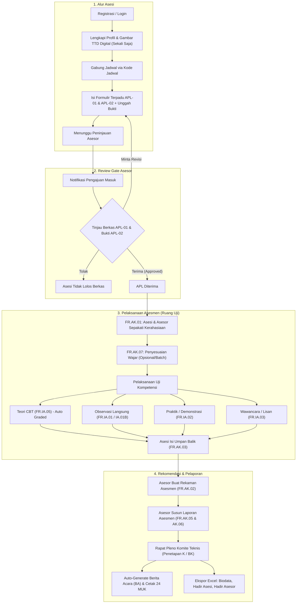

# Alur Sistem & Katalog Fitur Lengkap — LSP PrO Indo 2.0

Dokumen ini memuat panduan komprehensif alur kerja (*certification workflow*), arsitektur teknis, dan penjelasan lengkap seluruh fitur yang tersedia untuk masing-masing peran (*Super Admin, Admin LSP, Asesor Kompetensi, Asesi, dan Komite Teknis*).

---

## 1. Filosofi & Prinsip Desain LSP PrO Indo 2.0

1. **Alur 1-Arah Sederhana (*Single Streamlined Path*)**:
   - Menghilangkan alur birokratis yang berputar-putar.
   - Tanda tangan digital (*digital signature*) digambar **satu kali** di profil pengguna via HTML5 canvas, lalu otomatis diinjeksikan ke seluruh berkas MUK tanpa meminta tanda tangan ulang.
   - Formulir APL-01 dan APL-02 digabung dalam tampilan terpadu (*single-page workflow*).
2. **Tanpa Landing Page Publik (*Direct System Portal*)**:
   - Mengakses URL utama (`/`) langsung mengarahkan pengunjung ke `/login`.
   - Pengguna yang telah diautentikasi langsung diarahkan ke dasbor sesuai peran masing-masing.
3. **Anti-AI-Slop & Desain Bersih Otentik**:
   - Menggunakan palet resmi: **LSP Navy (`#1E2B6E`)**, **Dark Navy (`#162052`)**, **LSP Red (`#CE181E`)**, dan kanvas abu-abu lembut (`#F8FAFC`).
   - Border tegas 1px (`border-slate-200`), tipografi sans-serif modern (Plus Jakarta Sans & Inter), tanpa shadow tebal melayang.
4. **Presisi 24 Dokumen Cetak MUK Standar BNSP**:
   - Seluruh instrumen asesmen terintegrasi langsung dengan template cetak format A4 standar BNSP.
   - Dilengkapi ekspor data native Microsoft Excel (`.xlsx`) via PhpSpreadsheet dengan header warna navy resmi.

---

## 2. Diagram Alur Kerja Sertifikasi (End-to-End Workflow)



---

## 3. Penjelasan Fitur Lengkap Berdasarkan Peran (Role)

### A. Super Admin & Admin LSP
Admin bertindak sebagai pengendali operasional pusat seluruh skema, jadwal uji, verifikasi berkas, dan penerbitan dokumen sertifikasi.

1. **Dashboard Operasional Terpusat**:
   - Menampilkan metrik utama: total jadwal aktif, total asesi terdaftar, persentase kelulusan, dan status verifikasi berkas APL.
   - Tautan cepat (*quick actions*) ke seluruh modul operasional.
2. **Manajemen Jadwal Uji Kompetensi (TUK Bebas)**:
   - Membuat jadwal uji dengan fleksibilitas nama TUK teks bebas (*free-text* seperti nama bengkel resmi, sekolah mitra, atau lab).
   - Pengaturan kode unik jadwal (contoh: `SCH-2026-001`) yang dibagikan kepada peserta untuk bergabung.
   - Plotting asesor kompetensi yang bertugas pada jadwal tersebut.
   - Pemilihan instrumen asesmen yang akan digunakan (misal: IA.01, IA.02, IA.05).
3. **Fitur Role Switch Proxy (Impersonation Instan)**:
   - Akses di `/admin/proxy`.
   - Admin dapat beralih peran seketika (*switch account*) menjadi Asesor atau Asesi manapun tanpa perlu mengetahui password mereka.
   - Sangat membantu untuk verifikasi kendala teknis di lapangan.
   - Dilengkapi bilah atas (*top bar*) persisten untuk kembali ke akun Admin dalam 1 klik (`/proxy/switch-back`).
4. **Pusat Dokumen MUK & Auto-Generator Berita Acara**:
   - Mengunduh dan mencetak **24 Dokumen MUK Standar BNSP** per jadwal atau per asesi individual:
     - `FR.APL.01`, `FR.APL.02`, `FR.MAPA.01`, `FR.MAPA.02`
     - `FR.AK.01`, `FR.AK.02`, `FR.AK.03`, `FR.AK.04`, `FR.AK.05`, `FR.AK.06`, `FR.AK.07`
     - `FR.IA.01` s.d. `FR.IA.11`
   - **Auto-Generate Berita Acara (BA) Asesmen**: Rekapitulasi otomatis nama asesi yang dinyatakan Kompeten (K) dan Belum Kompeten (BK) beserta tanda tangan digital Asesor dan Admin.
   - **Ekspor Format Native Microsoft Excel (`.xlsx`)**:
     - Ekspor Biodata Peserta Asesi.
     - Ekspor Daftar Hadir Peserta Uji.
     - Ekspor Daftar Hadir Asesor Penguji.
5. **Master Data Sertifikasi**:
   - **Master Skema Otomotif**: 7 skema standar BNSP (`SKM-01-2026` s.d. `SKM-07-2026`).
   - **Master Unit, Elemen, dan KUK**: Rincian unit kompetensi, elemen kompetensi, dan kriteria unjuk kerja terstruktur.
   - **Bank Soal CBT (Pilihan Ganda)**: Bank soal teori dengan kunci jawaban, opsi A-D, dan relasi langsung ke unit kompetensi.
   - **Manajemen Pengguna**: Mengelola data asesi, asesor (beserta No. Reg MET), dan administrator.
6. **Layanan Pendukung BNSP**:
   - Penyelenggaraan Rapat Pleno Kelulusan (`/admin/pleno`).
   - Layanan Banding Asesmen (`/admin/appeals`).
   - Layanan Pengaduan & Aspirasi Publik (`/admin/complaints`).
   - Surveilans Pemegang Sertifikat (`/admin/surveillance`).

---

### B. Asesor Kompetensi
Asesor bertindak sebagai evaluator independen yang membimbing asesi dan menetapkan rekomendasi kompetensi.

1. **Dasbor Cockpit Asesor**:
   - Menampilkan seluruh jadwal uji yang ditugaskan kepada asesor tersebut.
   - Status jumlah asesi: Total peserta, asesi yang belum dinilai, dan asesi yang selesai dinilai.
2. **Profil Asesor & Nomor Registrasi MET BNSP**:
   - Penyimpanan No. Registrasi Asesor (MET), sertifikat kompetensi asesor, dan tanda tangan digital.
3. **APL Review Gate (Pemeriksaan Mandiri)**:
   - Meninjau formulir APL-01 (data diri & persyaratan dasar) dan APL-02 (asesmen mandiri portofolio bukti VATM: *Valid, Asli, Terkini, Memadai*).
   - Memberikan keputusan:
     - **Terima (Approved)**: Membuka akses Ruang Uji bagi asesi.
     - **Minta Revisi (Revision Requested)**: Disertai catatan bagian mana yang harus diperbaiki oleh asesi.
     - **Tolak (Rejected)**: Menolak permohonan dengan alasan tertentu.
4. **FR.AK.07 Penyesuaian yang Wajar dan Beralasan**:
   - Ceklis identifikasi karakteristik khusus asesi (opsional / batch).
   - Menyepakati penyesuaian alat/metode tanpa menurunkan standar kompetensi.
5. **Ruang Uji Instrumen Asesmen (Multi-Instrument Engine)**:
   - **FR.AK.01 (Persetujuan Asesmen)**: Verifikasi persetujuan asesmen dan komitmen kerahasiaan.
   - **FR.IA.01 & IA.01B (Ceklis Observasi)**: Penilaian unjuk kerja per KUK dengan opsi K (*Kompeten*) / BK (*Belum Kompeten*) dan catatan observasi.
   - **FR.IA.02 (Tugas Praktik Demonstrasi)**: Penilaian demonstrasi praktik asesi serta pemeriksaan dokumen/foto fisik yang diunggah.
   - **FR.IA.03 (Pertanyaan Lisan / Wawancara)**: Lembar tanya jawab konfirmasi untuk memastikan pemahaman dasar asesi.
   - **FR.IA.05 (Pemeriksaan Ujian Teori CBT)**: Meninjau nilai otomatis dari sistem CBT, rincian jawaban asesi, serta memberikan umpan balik per unit.
6. **Finalisasi & Sinkronisasi Dokumen Hasil Uji**:
   - **FR.AK.02 (Rekaman Asesmen)**: Auto-sinkronisasi seluruh unit kompetensi menjadi kesimpulan akhir: *Kompeten (K)* atau *Belum Kompeten (BK)*.
   - **FR.AK.05 (Laporan Asesmen)**: Pencatatan ringkasan pelaksanaan asesmen.
   - **FR.AK.06 (Meninjau Proses Asesmen)**: Evaluasi proses pelaksanaan sertifikasi.

---

### C. Asesi (Peserta Uji)
Asesi adalah calon peserta yang mendaftar dan mengikuti seluruh tahapan sertifikasi profesi secara mandiri dan transparan.

1. **Registrasi Akun Mandiri & Pengaturan Profil**:
   - Pendaftaran akun dengan NIK, nama lengkap, nomor WhatsApp, dan email.
   - **Signature Pad HTML5 Canvas**: Menggambar tanda tangan digital di layar sekali saja; tersimpan aman dan digunakan untuk seluruh dokumen sertifikasi.
2. **Pendaftaran Jadwal Asesmen (Join by Code)**:
   - Memasukkan kode jadwal yang diberikan oleh Admin/TUK untuk langsung terdaftar pada kegiatan uji yang sesuai.
3. **Formulir Terpadu APL-01 & APL-02**:
   - Pengisian data permohonan sertifikasi (APL-01) dan penilaian mandiri portofolio (APL-02) dalam satu alur yang intuitif.
   - Unggah berkas portofolio (Ijazah, Sertifikat Pelatihan, Surat Pengalaman Kerja, KTP) dengan pratinjau instan.
4. **Ruang Uji Asesi (Assessment Hub)**:
   - Terbuka otomatis setelah APL disetujui oleh Asesor.
   - **Tanda Tangan FR.AK.01**: Menandatangani persetujuan jadwal dan kerahasiaan materi uji.
   - **Ujian Teori CBT (FR.IA.05)**:
     - Antarmuka ujian modern dengan nomor soal navigasi cepat.
     - Soal diacak (*randomized*) dengan batasan waktu (*countdown timer*).
     - Hasil ujian langsung dihitung otomatis (*auto-graded*) sesuai passing grade skema.
   - **Unggah Hasil Demonstrasi (FR.IA.02)**: Mengunggah lembar kerja atau dokumentasi praktik kerja.
   - **Umpan Balik Asesi (FR.AK.03)**: Mengisi kuesioner evaluasi kepuasan pelaksanaan asesmen oleh asesor dan TUK.
   - **Banding Asesmen (FR.AK.04)**: Fasilitas resmi pengajuan banding apabila peserta merasa tidak puas terhadap keputusan hasil uji.

---

### D. Komite Teknis & Admin TUK

1. **Komite Teknis LSP**:
   - Mengkaji hasil rekomendasi asesor pada Rapat Pleno (`/admin/pleno`).
   - Menetapkan kelulusan final penerbitan sertifikat kompetensi berlogo Garuda BNSP.
2. **Admin Tempat Uji Kompetensi (TUK)**:
   - Mengelola kelayakan fasilitas sarana & prasarana bengkel/lab uji.
   - Memverifikasi absensi fisik peserta dan kelengkapan alat kerja sebelum uji kompetensi dimulai.

---

## 4. Panduan Akses & Akun Pengujian

Seluruh akun seeder otomotif LSP PrO Indo menggunakan kata sandi default:
```text
@Kompeten86
```

### Daftar Akun Default:

| Peran (*Role*) | Alamat Email | Kata Sandi | Deskripsi |
| :--- | :--- | :--- | :--- |
| **Super Admin** | `lsp.proindo@gmail.com` | `@Kompeten86` | Hak akses penuh sistem & konfigurasi |
| **Admin LSP** | `adminlsp@gmail.com` | `@Kompeten86` | Operasional jadwal, dokumen, & verifikasi |
| **Komite Teknis**| `komite@gmail.com` | `@Kompeten86` | Verifikasi rapat pleno kelulusan |
| **Asesor (1)** | `asesor.randi@gmail.com` | `@Kompeten86` | No. MET: `000.003921.2023` |
| **Asesor (2)** | `asesor.ari@gmail.com` | `@Kompeten86` | No. MET: `000.003922.2023` |
| **Asesor (3)** | `asesor.imam@gmail.com` | `@Kompeten86` | No. MET: `000.003923.2023` |
| **Asesor (4)** | `asesor.rizik@gmail.com` | `@Kompeten86` | No. MET: `000.003924.2023` |
| **Admin TUK** | `tukadmin@gmail.com` | `@Kompeten86` | Pengelola fasilitas Tempat Uji Kompetensi |
| **Asesi (1)** | `asesi1@gmail.com` | `@Kompeten86` | Peserta uji kompetensi otomotif |
| **Asesi (2)** | `asesi2@gmail.com` | `@Kompeten86` | Peserta uji kompetensi otomotif |
| **Asesi (3)** | `wahyu@gmail.com` | `@Kompeten86` | Peserta uji kompetensi otomotif |

> [!TIP]
> **Cara Cepat Berpindah Akun Tanpa Input Password:**
> 1. Masuk ke akun Admin (`adminlsp@gmail.com` / `@Kompeten86`).
> 2. Buka menu **Beralih Peran (Proxy)** di [`/admin/proxy`](file:///home/wahyuandika/Dokumen/coding-experiment/rea-application-lsp/resources/views/admin/proxy/index.blade.php).
> 3. Klik tombol **Masuk Sebagai Pengguna Ini** pada baris akun yang diinginkan.
> 4. Untuk kembali ke Admin, cukup klik tombol hijau **Kembali ke Akun Admin** di bagian paling atas layar.

---

## 5. Ringkasan Ekspor Berkas & Dokumen Cetak

| Format | Nama Berkas / Dokumen | Rute Sistem (*Route*) | Output / Karakteristik |
| :--- | :--- | :--- | :--- |
| **PDF / Print** | Berita Acara (BA) Uji Kompetensi | `admin.dokumen-muk.export-ba` | Standar BNSP, rekap asesi K / BK, TTD digital |
| **PDF / Print** | 24 Dokumen Lengkap MUK BNSP | `admin.dokumen-muk.index` | Layout A4 Portrait, kop resmi LSP, meta data lengkap |
| **Excel (`.xlsx`)** | Biodata Peserta Asesi | `admin.dokumen-muk.export-excel-biodata` | Header Navy `#1E2B6E`, border tipis, auto-size cell |
| **Excel (`.xlsx`)** | Daftar Hadir Peserta Uji | `admin.dokumen-muk.export-excel-hadir-asesi` | Header Navy `#1E2B6E`, kolom NIK, no telp, TTD tanda hadir |
| **Excel (`.xlsx`)** | Daftar Hadir Asesor Penguji | `admin.dokumen-muk.export-excel-hadir-asesor` | Header Navy `#1E2B6E`, nomor MET, jadwal uji, durasi asesmen |
