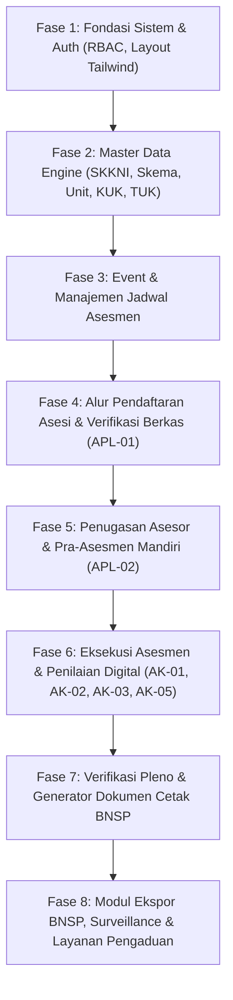

# Analisis Kebutuhan Rebuild Sistem LSP (Lembaga Sertifikasi Profesi)
**Basis Analisis**: Hasil Observasi Langsung Sistem Legacy `demo.aplikasilsp.web.id` (31 Oktober 2026)  
**Tujuan**: Rekomendasi arsitektur, pemetaan fitur, analisis gap, spesifikasi kepatuhan dokumen BNSP, urutan implementasi, dan komponen antarmuka untuk pembangunan ulang (*rebuild*) ke dalam repositori baru berbasis Laravel 13 dan Tailwind CSS.

---

## 1. Pemetaan Fitur Lama → Kebutuhan Baru

Sistem legacy dibangun dengan pola PHP prosedural lawas (monolitik script terpisah, navigasi berbasis query `media.php?module=xxx`, ketergantungan jQuery/Bootstrap 3). Pada sistem baru, arsitektur disederhanakan menjadi sistem modern berbasis **Role-Based Access Control (RBAC)** dengan 3 aktor utama: **Admin LSP**, **Asesor Kompetensi**, dan **Asesi (Peserta Uji)**.

### 1.1 Restrukturisasi Role (Keputusan Penyederhanaan)

| Role Lama | Status di Sistem Baru | Penanganan Alur Kerja di Sistem Baru |
|---|---|---|
| **Komite Teknis** | **DIHAPUS** (Tidak ada login terpisah) | **Dialihkan ke Admin / Pengelola LSP**. - Fungsi Rapat Pleno penetapan kelulusan dilakukan langsung pada modul Admin (Verifikasi Pleno). - Berita Acara Pleno dan Daftar Hadir Pleno di-generate secara otomatis oleh Admin berdasarkan data asesi yang direkomendasikan Kompeten (K) oleh Asesor. - Menghilangkan beban kredensial ganda dan ketergantungan login anggota komite. |
| **Tempat Uji Kompetensi (TUK)** | **DIHAPUS** (Tidak ada login terpisah) | **Dialihkan menjadi Master Data Entitas**. - TUK dikelola penuh oleh Admin sebagai data master fasilitas/lokasi (Nama TUK, Alamat, Jenis: Sewaktu/Mandiri/Tempat Kerja, PIC TUK, No. Lisensi TUK). - Form ceklis verifikasi kelayakan TUK diisi oleh Admin atau Asesor saat persiapan jadwal uji. - Tidak memerlukan portal login terpisah bagi pengelola TUK. |
| **Admin LSP** | **DIPERTAHANKAN & DIMODERNISASI** | Menjadi pusat kontrol tunggal operasional: master data skema & MUK, manajemen jadwal, plotting asesor & asesi, verifikasi berkas, persetujuan hasil uji (pleno), monitoring keuangan, dan ekspor pelaporan BNSP. |
| **Asesor** | **DIPERTAHANKAN & DIMODERNISASI** | Portal kerja penilaian digital: menerima penugasan (Surat Tugas), verifikasi asesmen mandiri (FR-APL-02), persetujuan asesmen (FR-AK-01), pengisian lembar observasi/rekaman asesmen (FR-AK-02), penandatanganan digital, dan penerbitan laporan asesmen (FR-AK-05). |
| **Asesi** | **DIPERTAHANKAN & DIMODERNISASI** | Portal mandiri peserta uji: registrasi akun & pengisian biodata, pemilihan skema & jadwal, unggah portofolio/berkas syarat (FR-APL-01), pengisian asesmen mandiri (FR-APL-02), penandatanganan persetujuan (FR-AK-01), pengisian kuesioner umpan balik (FR-AK-03), serta unduh sertifikat / hasil asesmen. |

---

### 1.2 Matriks Pemetaan Modul Sistem Lama vs Sistem Baru

#### A. Area Publik & Pendaftaran
| Modul Sistem Lama | URL Lama | Rekomendasi Sistem Baru | Alasan & Catatan Perubahan |
|---|---|---|---|
| Landing Page Utama | `/index.php` | Halaman Depan Modern (Tailwind) | Mengganti Revolution Slider & asset jQuery lama dengan Hero Section responsif, katalog skema pencarian cepat, direktori asesor, dan status lisensi resmi BNSP. |
| Pendaftaran Asesi | `/daftarasesi.php`, `/pendaftaran.php` | Form Registrasi Multi-Step Asesi | Validasi NIK unik, email, nomor HP/WhatsApp aktif, cascading wilayah (Provinsi/Kota/Kec/Kel) via fetch dinamis, auto-generate akun asesi. |
| Layanan Pengaduan | `/pengaduan.php`, `/pengaduansend.php` | Form Pengaduan Publik + Tracking Tiket | Integrasi captcha modern / turnstile, sistem penomoran tiket aduan unik, notifikasi aduan ke dashboard admin. |
| Layanan Surveillance | `/surveillance.php` | Modul Pemantauan Pemegang Sertifikat | Formulir online pelaporan status kerja bagi asesi yang telah bersertifikat, terhubung ke database pemegang sertifikat. |
| Informasi Skema & TUK | `/skema.php`, `/tuk.php`, `/jadwal.php` | Katalog Skema, Jadwal & TUK Publik | Tampilan direktori modern dengan filter instan (pencarian real-time tanpa refresh halaman). |
| Direktori Asesor | `/asesorpenguji.php` | Direktori Asesor Terlisensi | Menampilkan daftar asesor aktif dengan status sertifikat kompetensi dan nomor MET. |

#### B. Modul Operasional Admin
| Modul Sistem Lama | Modul / Query Lama | Rekomendasi Sistem Baru | Alasan & Catatan Perubahan |
|---|---|---|---|
| Dashboard | `?module=home` | Dashboard Analitik LSP | Mengganti chart statis dengan metrik real-time: Asesi Aktif, Jadwal Berjalan, Tingkat Kelulusan (K vs BK), Antrian Verifikasi Berkas. |
| Master Profil LSP | `?module=lsp` | Pengaturan Profil Lembaga | Pengaturan identitas LSP, nomor lisensi BNSP, logo resmi, tanda tangan digital Ketua LSP, format kop surat resmi. |
| Standar SKKNI & Skema | `?module=skkni`, `?module=skema` | Master Data Standar & Skema Kompetensi | Struktur hierarki data terstandarisasi: SKKNI/Standar Khusus/Internasional → Skema Sertifikasi → Unit Kompetensi → Elemen Kompetensi → Kriteria Unjuk Kerja (KUK). |
| Dokumen Mutu | `?module=docmutu` | Manajemen Dokumen Mutu LSP | Repository penyimpanan dokumen mutu (Panduan Mutu, SOP, Formulir Kerja, Bukti Rekaman) dengan manajemen versi. |
| Event & Jadwal Asesmen | `?module=event`, `?module=agendaasesmen`, `?module=jadwalasesmen` | Manajemen Jadwal & Pelaksanaan Asesmen | Konsolidasi menu: Menggabungkan `event`, `agenda`, dan `jadwal` menjadi satu modul manajemen siklus hidup asesmen (*Event Creation → Setup Kuota & TUK → Plotting Asesor → Plotting Asesi → Monitoring Hasil*). |
| Master TUK | `?module=tuk` | Master Data Tempat Uji Kompetensi | Data master sarana prasarana TUK (jenis TUK: Sewaktu / Mandiri / Tempat Kerja, alamat, penanggung jawab). |
| Manajemen Asesi | `?module=asesibaru`, `?module=asesibv`, `?module=asesiv`, `?module=asesik` | Pipeline Status Asesi (*Kanban / Filterable List*) | Mengganti 4 submenu terpisah menjadi 1 antarmuka dengan filter status: *Baru Mendaftar → Belum Verifikasi → Terverifikasi Syarat → Terjadwal → Selesai Asesmen*. |
| Manajemen Asesor | `?module=asesor`, `?module=rekamjejakasesor` | Master Data & Rekam Jejak Asesor | Profil asesor, No. Registrasi MET, masa berlaku sertifikat asesor, rekam jejak penguji, penyusun MAPA, dan validasi instrumen. |
| Laporan Sertifikasi | `?module=laporan`, `?module=lapbymo` (12 submenu) | Laporan Fleksibel dengan Filter Tanggal | Menghapus 12 submenu bulanan terpisah; diganti satu view laporan analitik dengan date-picker bulanan/tahunan yang dapat diekspor ke Excel dan PDF. |
| Ekspor BNSP | `admin/exporthasilasesmen.php` | BNSP Data Exporter (XLS/XML) | Menghasilkan file Excel/XML Spreadsheet dengan struktur kolom yang 100% kompatibel dengan sistem pelaporan BNSP. |
| Keuangan & Biaya | `?module=rekening`, `?module=biayauji`, `?module=keuangan` (12 submenu) | Billing & Verifikasi Pembayaran Sederhana | Master rekening tujuan, biaya uji per skema, upload bukti bayar oleh asesi, dan tombol konfirmasi pelunasan oleh admin. |
| Persuratan | `?module=persuratan` (12 submenu) | Generator Surat Resmi Otomatis | Template surat dinamis: Surat Tugas Asesor Penguji, Penyusun MAPA, Verifikasi TUK, Berita Acara, dan Surat Keputusan Hasil Asesmen. |

#### C. Portal Asesor
| Modul Sistem Lama | Modul Asesor Lama | Rekomendasi Sistem Baru | Alasan & Catatan Perubahan |
|---|---|---|---|
| Dashboard Asesor | `asesor/media.php?module=home` | Dashboard Tugas Asesor | Rekap jadwal uji aktif, jumlah asesi yang ditugaskan, status penilaian yang belum tuntas. |
| Surat Tugas | `asesor/media.php?module=surattugas` | Arsip & Unduh Surat Tugas | Menampilkan daftar surat penugasan resmi dari LSP beserta dokumen pendukung (MAPA, daftar peserta). |
| Penilaian Asesmen Mandiri | `asesor/media.php?module=asesmenmandiri` | Verifikasi FR-APL-02 Digital | Antarmuka peninjauan bukti portofolio asesi per elemen kompetensi dengan toggle keputusan (Lanjut Asesmen / Belum Lanjut). |
| Instrumen Uji (FR-AK-02) | `asesor/media.php?module=penilaian` | Lembar Penilaian Asesmen Interaktif | Matriks penilaian KUK terintegrasi: checklist bukti observasi/demonstrasi/lisan/tertulis dengan tombol toggle cepat Kompeten (K) / Belum Kompeten (BK). |
| Laporan Asesmen (FR-AK-05) | `asesor/media.php?module=laporanasumsi` | Rekapitulasi & Rekomendasi Asesmen | Pengisian catatan asesmen kelompok dan penandatanganan digital laporan akhir asesmen. |

#### D. Portal Asesi
| Modul Sistem Lama | Modul Asesi Lama | Rekomendasi Sistem Baru | Alasan & Catatan Perubahan |
|---|---|---|---|
| Dashboard Asesi | `asesi/media.php?module=home` | Dashboard Status Sertifikasi | Visualisasi alur progres (Pendaftaran → Verifikasi Berkas → Pembayaran → Pra-Asesmen → Uji Kompetensi → Pleno → Terbit Sertifikat). |
| Formulir APL-01 | `asesi/media.php?module=apl01` | Profil & Pengajuan Sertifikasi | Kelola data biodata, instansi, dan upload berkas bukti persyaratan dasar. |
| Asesmen Mandiri (APL-02) | `asesi/media.php?module=apl02` | Pengisian FR-APL-02 Interaktif | Checklist mandiri per KUK dengan upload/linking bukti pendukung (Ijazah, Sertifikat Pelatihan, Surat Keterangan Kerja, dll.). |
| Persetujuan Asesmen (AK-01) | `asesi/media.php?module=ak01` | Konfirmasi & Tanda Tangan AK-01 | Penandatanganan klausul persetujuan asesmen dan kerahasiaan sebelum uji kompetensi dimulai. |
| Umpan Balik (AK-03) | `asesi/media.php?module=ak03` | Kuesioner Evaluasi Asesmen | Form penilaian kepuasan asesi terhadap proses asesmen dan asesor. |
| Pengajuan Banding (AK-04) | `asesi/media.php?module=banding` | Formulir Banding Asesmen | Pengajuan banding resmi jika asesi berkeberatan atas rekomendasi Belum Kompeten (BK). |

---

## 2. Kesenjangan (Gap Analysis) & Keputusan Desain

Berikut adalah daftar fitur dan arsitektur yang memerlukan persetujuan sebelum implementasi:

### Gap 1: Mekanisme Autentikasi & Keamanan Login (2FA / OTP)
- **Kondisi Sistem Lama**: Setiap login akun non-admin (Asesor, Asesi, Komite, TUK) dipaksa memasukkan OTP 6 digit yang dikirimkan via SMS/WhatsApp gateway. Pada kenyataannya di server demo, pesan OTP tersebut hanya tersimpan di database lokal tabel `sent`.
- **Pertimbangan Sistem Baru**:
  - *Opsi A (Direkomendasikan)*: Autentikasi modern standar berbasis **Email & Password Terenkripsi (Bcrypt/Argon2id)** dengan fitur *Remember Me* dan *Rate Limiting* (anti brute-force). OTP opsional atau hanya digunakan untuk aksi kritis (misal reset password atau submit nilai akhir).
  - *Opsi B*: Tetap mewajibkan 2FA OTP untuk Asesor dan Asesi via WhatsApp / Email setiap kali login.
- **Rekomendasi**: Gunakan **Opsi A** untuk kemudahan penggunaan dan keandalan sistem tanpa ketergantungan kuota pulsa SMS/WA Gateway pihak ketiga.

### Gap 2: Layanan Notifikasi (WhatsApp vs Email SMTP)
- **Kondisi Sistem Lama**: Memiliki konfigurasi `wacenter` dan `smtp`, namun praktiknya terikat pada script pengiriman SMS lokal.
- **Pertimbangan Sistem Baru**:
  - *Pilihan*: Notifikasi email transaksional resmi (Mailgun / Resend / SMTP lokal) untuk bukti pendaftaran, jadwal asesmen, dan pengumuman hasil. Jika integrasi WhatsApp Gateway diperlukan, sediakan modular driver (misal: Fonnte / Wablas / generic webhook) yang dapat diaktifkan/dinonaktifkan melalui file `.env`.

### Gap 3: Integrasi Data BNSP (Direct API vs Format Ekspor Spreadsheet)
- **Kondisi Sistem Lama**: Menggunakan form konfigurasi akun BNSP, namun ekspor data asesmen dilakukan dalam bentuk file XML Spreadsheet (`exporthasilasesmen.php`).
- **Pertimbangan Sistem Baru**:
  - Sistem baru memprioritaskan pembuatan **Generator Ekspor Spreadsheet Standar BNSP** (`.xlsx` / XML) yang 100% presisi dengan kolom Sisfo BNSP. Skema data internal disiapkan dengan field `id_jadwal_bnsp` dan `kode_skema_bnsp` agar jika ke depannya BNSP merilis REST API resmi, adaptor sinkronisasi dapat langsung disambungkan.

### Gap 4: Penomoran Surat Otomatis vs Input Manual
- **Kondisi Sistem Lama**: Admin menginput nomor surat tugas atau nomor sertifikat secara manual pada form input text.
- **Pertimbangan Sistem Baru**:
  - Sediakan pola penomoran otomatis yang dapat dikonfigurasi (*format template sequence*, contoh: `{NOMOR}/ST-LSP/{BULAN_ROMAWI}/{TAHUN}`), dengan opsi bagi admin untuk menimpa (*override*) nomor tersebut secara manual jika diperlukan.

### Gap 5: Ruang Lingkup Modul Keuangan
- **Kondisi Sistem Lama**: Terdapat 12 submenu keuangan (Pemasukan, Pengeluaran, Piutang, dll.) namun sebagian besar hanya tabel catatan statis.
- **Pertimbangan Sistem Baru**:
  - Fokuskan modul keuangan pada **Pelacakan Pembayaran Asesmen**: Penetapan tarif per skema, unggah bukti transfer oleh asesi, verifikasi pembayaran oleh kasir/admin, dan penerbitan kuitansi/invoice PDF otomatis. Laporan pembukuan akuntansi umum disarankan tidak memperumit alur sertifikasi inti.

### Gap 6: Tanda Tangan Digital (Canvas Signature vs QR Code Verifikasi)
- **Kondisi Sistem Lama**: Menyimpan goresan tanda tangan dalam bentuk base64 PNG dari HTML canvas.
- **Pertimbangan Sistem Baru**:
  - Pertahankan **HTML5 Canvas Digital Signature Pad** untuk penandatanganan dokumen formulir MUK (FR-APL, FR-AK).
  - Tambahkan fitur **QR Code Verifikasi Resmi** pada dokumen cetak publik (Surat Tugas, Berita Acara, Sertifikat) yang mengarah ke URL validasi keaslian dokumen di domain LSP.

---

## 3. Spesifikasi Field & Dokumen Wajib Identik (Kepatuhan BNSP)

Untuk menjamin kepatuhan terhadap regulasi Badan Nasional Sertifikasi Profesi (BNSP), dokumen-dokumen resmi berikut wajib mengikuti struktur, field, dan tata letak standar:

### 3.1 FR-APL-01: Formulir Permohonan Sertifikasi Kompetensi
- **Header**: Kop Surat Resmi LSP, Logo LSP, Logo Lisensi BNSP, Judul formulir: `FR-APL-01. FORMULIR PERMOHONAN SERTIFIKASI KOMPETENSI`.
- **Bagian 1: Rincian Data Pemohon Sertifikasi**:
  - *Data Pribadi*: Nama Lengkap, No. KTP/NIK/Paspor, Tempat & Tanggal Lahir, Jenis Kelamin (L/P), Kebangsaan, Alamat Rumah (Jalan, RT/RW, Kelurahan, Kecamatan, Kota/Kabupaten, Provinsi, Kode Pos), No. Telepon/HP, Email Pribadi, Kualifikasi Pendidikan Terakhir.
  - *Data Pekerjaan Sekarang*: Nama Lembaga/Perusahaan, Jabatan/Posisi, Alamat Kantor, No. Telp Kantor, Email Kantor.
- **Bagian 2: Data Sertifikasi**:
  - Judul Skema Sertifikasi, Nomor Skema Sertifikasi.
  - Tujuan Asesmen: Checklist pilihan (*Sertifikasi Baru / Sertifikasi Ulang (RCC) / Pengakuan Kompetensi Terkini (PKT) / Rekognisi Pembelajaran Lampau (RPL) / Lainnya*).
  - Tabel Daftar Unit Kompetensi Kemasan: No, Kode Unit, Judul Unit, Jenis Standar (SKKNI/Standar Khusus/Internasional).
- **Bagian 3: Bukti Kelengkapan Pemohon**:
  - Tabel Persyaratan Dasar: No, Dokumen Persyaratan (KTP, Ijazah, CV, Sertifikat Pelatihan, Surat Pengalaman Kerja), Status Kelengkapan (Ada / Tidak Ada), Verifikasi LSP (Memenuhi / Tidak Memenuhi).
- **Bagian Pengesahan & Rekomendasi**:
  - Tanda tangan & Tanggal Asesi Pemohon.
  - Catatan Verifikator LSP: Rekomendasi (*Diterima sebagai peserta sertifikasi / Tidak diterima*).
  - Tanda tangan & Nama Admin/Verifikator LSP, No. Registrasi LSP.

### 3.2 FR-APL-02: Formulir Asesmen Mandiri
- **Header**: Data Asesi, Nama Asesor, Judul Skema, Nomor Skema, Tanggal Asesmen, Nama TUK.
- **Tabel Unit & Bukti Kompetensi**:
  - Dikelompokkan per Unit Kompetensi (Kode Unit & Judul Unit).
  - Baris Elemen Kompetensi & Kriteria Unjuk Kerja (KUK).
  - Kolom Pilihan Mandiri Asesi: Radio button `K` (Kompeten) atau `BK` (Belum Kompeten).
  - Kolom Bukti Pendukung: Daftar bukti portofolio yang dilampirkan (kode bukti).
  - Kolom Tinjauan Asesor: Bukti Relevan (V/A/T/M: Valid, Asli, Terkini, Memadai).
- **Rekomendasi Asesor**:
  - Checklist: *Asesmen dapat dilanjutkan / Asesmen tidak dapat dilanjutkan*.
  - Catatan untuk Asesi.
  - Tanda Tangan Asesi + Tanda Tangan Asesor + Tanggal Peninjauan.

### 3.3 FR-AK-01: Formulir Persetujuan Asesmen dan Kerahasiaan
- **Field Identitas**: Nama Asesi, Nama Asesor, Judul Skema Sertifikasi, Hari/Tanggal Pelaksanaan, Waktu/Durasi, Tempat Uji Kompetensi.
- **Pernyataan Asesor**:
  - Pernyataan menjamin kerahasiaan materi uji dan objektivitas asesmen.
- **Pernyataan Asesi**:
  - Pernyataan menyetujui hak dan kewajiban selama proses asesmen, serta kesediaan menyelesaikan seluruh tahapan uji.
- **Pengesahan**:
  - Tanda tangan digital Asesi dan Tanda tangan digital Asesor Penguji.

### 3.4 FR-AK-02: Formulir Rekaman Asesmen Kompetensi
- **Header**: Skema Sertifikasi, TUK, Asesor Penguji, Asesi, Tanggal Pelaksanaan.
- **Matriks Penilaian per Unit Kompetensi**:
  - Tabel Unit Kompetensi, Elemen, dan KUK.
  - Penandaan Metode Penilaian yang Digunakan:
    - Bukti Langsung: Observasi Demonstrasi (L).
    - Bukti Tidak Langsung: Verifikasi Portofolio (TL).
    - Bukti Tambahan: Pertanyaan Lisan / Tertulis (T).
  - Kolom Rekomendasi per Unit: `K` (Kompeten) atau `BK` (Belum Kompeten).
- **Rekomendasi Keseluruhan Asesmen**:
  - Rekomendasi Akhir: **Kompeten (K)** atau **Belum Kompeten (BK)** untuk seluruh skema.
  - Tindak Lanjut yang Dibutuhkan (jika BK).
  - Komentar / Catatan Asesor Penguji.
  - Tanda Tangan Asesi (menerima rekomendasi) & Tanda Tangan Asesor Penguji.

### 3.5 FR-AK-03: Formulir Umpan Balik dan Catatan Asesmen
- **Kuesioner Evaluasi (Skala Ya / Tidak & Komentar)**:
  1. Apakah asesi diberikan penjelasan tentang proses asesmen sebelum pelaksanaan?
  2. Apakah asesi menyepakati rencana asesmen dan instrumen yang digunakan?
  3. Apakah asesor menjelaskan hak banding kepada asesi?
  4. Apakah asesor bersikap adil, objektif, dan tidak diskriminatif?
  5. Apakah asesor memberikan umpan balik yang konstruktif terkait hasil asesmen?
  6. Catatan / saran perbaikan untuk LSP dan TUK.
- **Pengesahan**: Tanda tangan Asesi.

### 3.6 FR-AK-05: Laporan Asesmen
- **Header**: Nomor Jadwal/Event, Skema Sertifikasi, Tanggal, TUK, Asesor Penguji.
- **Tabel Rekapitulasi Peserta**:
  - No, Nama Asesi, No. Identitas/NIK, Instansi, Rekomendasi Akhir (K / BK), Catatan Khusus.
- **Ringkasan Pelaksanaan Asesmen**:
  - Aspek positif pelaksanaan uji, kendala/hambatan yang dihadapi, saran perbaikan instrumen uji untuk kaji ulang MUK.
- **Pengesahan**: Tanda tangan seluruh Asesor yang bertugas dalam jadwal tersebut.

### 3.7 Berita Acara Asesmen & Daftar Hadir
- **Berita Acara Pelaksanaan Asesmen**:
  - Nomor Berita Acara, Waktu pelaksanaan (Hari, Tanggal, Jam), Lokasi TUK.
  - Rekapitulasi: Total Peserta Terdaftar, Total Hadir, Total Tidak Hadir, Total Direkomendasikan Kompeten (K), Total Belum Kompeten (BK).
  - Tanda tangan Asesor Penguji dan Penanggung Jawab TUK / Admin LSP.
- **Daftar Hadir Asesmen**:
  - Format Presensi Peserta: No, No. Peserta, Nama Asesi, No. KTP, Instansi, Tanda Tangan Sesi Pagi, Tanda Tangan Sesi Siang.
  - Format Presensi Asesor: No, Nama Asesor, No. Registrasi MET, Peran (Penguji / Lead), Tanda Tangan.

### 3.8 Surat Tugas Asesor
- **Format**: Dokumen resmi berkop surat LSP dengan nomor surat dinamis.
- **Konsiderans**: Dasar hukum penugasan, Surat Keputusan Direktur LSP, referensi lisensi BNSP.
- **Diktum Penugasan**: Menugaskan nama asesor (beserta No. MET) untuk melaksanakan asesmen pada skema, jadwal, dan TUK tertentu.
- **Lampiran**: Daftar nama asesi yang ditugaskan kepada asesor tersebut.
- **Pengesahan**: Kota penerbitan, Tanggal, Tanda Tangan & Cap Direktur/Ketua LSP.

### 3.9 Ekspor Format BNSP (Spreadsheet `.xls`)
- File spreadsheet XML yang dihasilkan wajib memuat kolom persis berikut:
  1. `NO`
  2. `NIK` (16 digit angka)
  3. `NO_PESERTA` / No. Pendaftaran
  4. `NAMA_LENGKAP`
  5. `TEMPAT_LAHIR`
  6. `TANGGAL_LAHIR` (`YYYY-MM-DD`)
  7. `JENIS_KELAMIN` (`L` / `P`)
  8. `PENDIDIKAN_TERAKHIR`
  9. `KODE_SKEMA`
  10. `NAMA_SKEMA`
  11. `KODE_TUK`
  12. `NAMA_TUK`
  13. `NO_REG_ASESOR` (No. MET)
  14. `NAMA_ASESOR`
  15. `HASIL_ASESMEN` (`K` / `BK`)
  16. `TANGGAL_ASESMEN` (`YYYY-MM-DD`)

---

## 4. Rekomendasi Urutan Implementasi (Prioritas Berdasarkan Dependensi Data)

Arsitektur aplikasi LSP memiliki rantai ketergantungan data (*data dependency chain*) yang sangat ketat: *Standar → Skema → Unit/KUK → TUK & Jadwal → Pendaftaran Asesi → Plotting Jadwal → Pra-Asesmen (APL-02) → Pelaksanaan (AK-01 & AK-02) → Rekomendasi (AK-05) → Pleno → Sertifikasi & Pelaporan*.

Berikut tahapan implementasi yang direkomendasikan secara berurutan:

### Rincian Tiap Fase:

- **Fase 1: Fondasi Sistem, Desain & Autentikasi (Sprint 1)**
  - Inisialisasi proyek Laravel 13, setup Tailwind CSS (konfigurasi warna netral profesional, tipografi fungsional, tanpa kit template bengkak).
  - Skema database pengguna (User), Role & Permission (Admin, Asesor, Asesi).
  - Alur otentikasi aman: Login, Register Asesi, Reset Password, Profil Pengguna.
  - Komponen layout navigasi terpadu (Header, Sidebar responsif, Toast alert).

- **Fase 2: Master Data Engine (Sprint 2)**
  - Profil LSP & Pengaturan Lembaga (Kop surat, lisensi BNSP, logo, tanda tangan direktur).
  - Entitas Master: SKKNI/Standar Acuan.
  - Skema Sertifikasi (Kode, Judul, Kategori, Dokumen Persyaratan Pendaftaran).
  - Unit Kompetensi, Elemen Kompetensi, dan KUK (Kriteria Unjuk Kerja).
  - Master TUK (Tempat Uji Kompetensi) dan data sarana prasarana.
  - Master Asesor (Biodata, No. MET, masa berlaku lisensi, spesialisasi skema).

- **Fase 3: Event & Manajemen Jadwal Asesmen (Sprint 3)**
  - Manajemen Event Asesmen (Tahun Anggaran / Sumber Anggaran: BNSP, Mandiri, APBN/APBD).
  - Pembuatan Jadwal Uji Kompetensi (Relasi: Event + Skema + TUK + Tanggal Pelaksanaan + Kuota Peserta).
  - Kalender jadwal dan integrasi tampilan jadwal publik di halaman depan.

- **Fase 4: Alur Pendaftaran Asesi & Verifikasi Berkas APL-01 (Sprint 4)**
  - Formulir pendaftaran mandiri calon asesi (biodata lengkap, cascading dropdown wilayah).
  - Pemilihan skema dan unggah berkas persyaratan permohonan sertifikasi.
  - Antarmuka Admin untuk verifikasi kelengkapan berkas (Diterima / Perlu Revisi / Ditolak).
  - Plotting asesi yang terverifikasi ke dalam jadwal asesmen aktif.

- **Fase 5: Penugasan Asesor & Pra-Asesmen Mandiri (Sprint 5)**
  - Plotting Asesor Penguji ke jadwal asesmen & auto-generate Surat Tugas Asesor.
  - Portal Asesi: Pengisian Formulir Asesmen Mandiri (FR-APL-02) berbasis KUK dan penautan portofolio.
  - Portal Asesor: Peninjauan dan verifikasi bukti APL-02 asesi (Rekomendasi lanjut uji / belum lanjut).

- **Fase 6: Eksekusi Asesmen & Penilaian Digital (Sprint 6)**
  - Persetujuan Asesmen & Kerahasiaan (FR-AK-01) dengan Tanda Tangan Canvas Digital oleh Asesi dan Asesor.
  - Matriks Penilaian Digital (FR-AK-02) untuk Asesor: Checklist metode uji (L/TL/T) dan penentuan K/BK per unit.
  - Kuesioner Umpan Balik Asesmen (FR-AK-03) diisi mandiri oleh Asesi setelah uji kompetensi.
  - Penyusunan Laporan Asesmen (FR-AK-05) oleh Asesor kepada LSP.

- **Fase 7: Verifikasi Pleno & Generator Dokumen Resmi BNSP (Sprint 7)**
  - Modul Verifikasi Pleno oleh Admin (pengganti peran Komite Teknis) untuk penetapan kelulusan final.
  - Engine Generator PDF Resmi (menggunakan DomPDF / Snappy):
    - Surat Tugas Asesor Penguji & MAPA.
    - Berita Acara Asesmen & Presensi Daftar Hadir (Peserta & Asesor).
    - Berita Acara Pleno Hasil Asesmen.
    - Cetak Formulir MUK lengkap: FR-APL-01, FR-APL-02, FR-AK-01, FR-AK-02, FR-AK-03, FR-AK-05.

- **Fase 8: Ekspor BNSP, Surveillance, Pengaduan & Polish (Sprint 8)**
  - Generator Ekspor Spreadsheet Excel/XML standar Sisfo BNSP.
  - Modul Surveillance online pemegang sertifikat.
  - Modul Layanan Pengaduan publik dan tindak lanjut aduan.
  - Pengujian terpadu (*End-to-End Test*), optimasi performa query, dan pembersihan aset.

---

## 5. Daftar Komponen Interaktif Wajib (Modern & Non-Static UI)

Agar sistem baru tidak terasa kaku atau sekadar form CRUD statis tahun 2010-an, komponen-komponen interaktif berikut wajib diimplementasikan:

1. **Tabel Data Dinamis dengan Filter & Pencarian Cepat (*Instant Client/Server Search*)**:
   - Filter instan tanpa reload halaman penuh (pencarian teks, filter skema, filter status verifikasi, filter tanggal).
   - Pagination interaktif yang mempertahankan state parameter pencarian URL.
   - Pilihan ekspor cepat (*Export Selected* ke CSV/Excel).

2. **Modal Dialog Review Cepat (*Drawer / Quick View Modal*)**:
   - Meninjau dokumen lampiran asesi (KTP, Ijazah, Sertifikat Pelatihan) langsung di samping form verifikasi tanpa perlu membuka tab browser baru.
   - Tombol verifikasi satu-klik (*Accept / Request Revision*) langsung dari dalam modal.

3. **Dropdown Wilayah Bertingkat (*Cascading Address Selector*)**:
   - Dropdown dinamis Provinsi → Kabupaten/Kota → Kecamatan → Kelurahan yang responsif dan dilengkapi animasi *loading indicator* halus saat mengambil data child.

4. **Digital Signature Pad Interaktif (HTML5 Canvas)**:
   - Komponen tanda tangan sentuh (*touch/mouse*) yang responsif di layar ponsel maupun desktop.
   - Dilengkapi tombol *Bersihkan (Clear)*, *Undo*, serta konversi otomatis ke PNG transparan.

5. **Matriks Penilaian Cepat FR-APL-02 & FR-AK-02 (*Batch Evaluator*)**:
   - Tombol pintasan: *"Tandai Semua Kompeten (K)"* untuk mempercepat pengisian puluhan KUK yang memenuhi syarat.
   - Validasi visual instan (indikator warna hijau untuk K dan kuning/merah untuk BK) agar asesor tidak melewatkan satupun kriteria unjuk kerja sebelum tombol submit aktif.

6. **Toast Alert & Dialog Konfirmasi Non-Intrusif**:
   - Menggantikan alert bawaan browser (`alert()` / `confirm()`) dengan floating toast notification (sukses, peringatan, gagal) dan modal konfirmasi elegan untuk aksi destruktif (hapus data, batalkan jadwal).

7. **Pratinjau Dokumen Cetak Langsung (*In-App PDF Live Viewer*)**:
   - Menyediakan modal pratinjau dokumen cetak sebelum tombol unduh/cetak ditekan, memastikan tata letak dan isian data sudah presisi.
