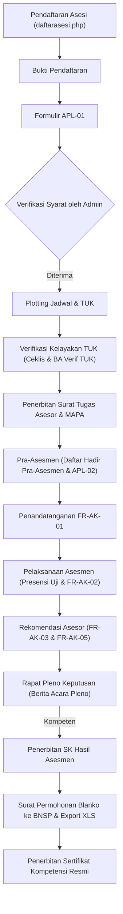

# Dokumentasi Hasil Investigasi Menyeluruh & Pemetaan Sistem Aplikasi LSP
**Target Sistem**: `https://demo.aplikasilsp.web.id`  
**Waktu Observasi**: 31 Oktober 2026  
**Metode Observasi**: Otomasi browser langsung via Chromium CDP (`capture_browser_scenario` REA MCP), analisis payload & headers HTTP, inspeksi DOM, parsing PDF dokumen cetak (`pdftotext`), dan tracing aliran data sesi terotentikasi.

---

## 1. Peta Publik (Sitemap, Endpoint, PWA/non-PWA)

### 1.1 Status PWA
- **PWA Status**: **NON-PWA** (Aplikasi web tradisional berbasis Server-Side Rendered PHP / Apache).
- **Pemeriksaan Endpoint PWA**:
  - `GET /manifest.json` -> HTTP `404 Not Found`
  - `GET /sw.js` -> HTTP `404 Not Found`
  - `GET /service-worker.js` -> HTTP `404 Not Found`
- **Frontend Stack**: jQuery 3.7.1, Bootstrap 3.3.6 / Custom Angle Theme, Select2 4.1.0-rc.0, Revolution Slider 5.0.7, FontAwesome 4.5.0 / Ionicons, Chart.js 2, jQuery UI & Signature Pad. Tidak menggunakan framework SPA (Vue/React/Angular). Routing sepenuhnya server-rendered menggunakan pola query parameter `media.php?module=<nama_modul>`.

### 1.2 Sitemap Halaman Publik (Sebelum Login)
| No | Path / URL | Fungsi Halaman | Form & Komponen Kunci | Endpoint Terkait |
|---|---|---|---|---|
| 1 | `/index.php` (Root) | Landing page utama | Slider hero banner, statistik infografis, ringkasan skema kompetensi, daftar asesor penguji, pencarian publik | `GET /`, `GET /foto_konten/...`, `GET /captcha.php` |
| 2 | `/daftarasesi.php` | Pendaftaran mandiri calon asesi | Form registrasi biodata lengkap, dropdown cascading wilayah bertingkat, kode keamanan captcha | POST ke `pendaftaran.php`, AJAX ke `config/getkota.php`, `getkecamatan.php`, `getkelurahan.php` |
| 3 | `/pengaduan.php` | Formulir layanan pengaduan publik | Form aduan masyarakat / asesi dengan nomor HP, jenis responden, isi aduan, captcha | POST ke `pengaduansend.php` |
| 4 | `/surveillance.php` | Pelaporan surveillance pemegang sertifikat | Form update status pekerjaan, instansi, jabatan, proyek, dan relevansi sertifikat | POST ke `postsurveillance.php` |
| 5 | `/persyaratan.php` | Informasi persyaratan skema sertifikasi | Accordion daftar skema dan dokumen persyaratan yang wajib dipenuhi pemohon | `GET /persyaratan.php` |
| 6 | `/jadwal.php` | Informasi jadwal uji kompetensi publik | Accordion jadwal pelaksanaan asesmen uji kompetensi | `GET /jadwal.php` |
| 7 | `/tuk.php` | Informasi Tempat Uji Kompetensi | Daftar TUK resmi pelaksana asesmen | `GET /tuk.php` |
| 8 | `/skema.php` | Katalog skema kompetensi | Daftar link skema kompetensi (`skema.php?idskx=<id>`) | `GET /skema.php`, `GET /skema.php?idskx=...` |
| 9 | `/asesorpenguji.php` | Direktori asesor kompetensi terdaftar | Tabel data asesor (No, Provinsi, Nama, No. Registrasi, No. Blangko, No. Sertifikat, Masa Berlaku, Status) | `GET /asesorpenguji.php` |
| 10 | `/about.php` | Profil lembaga sertifikasi profesi | Deskripsi profil, lisensi BNSP, counter statistik asesi/asesor | `GET /about.php` |
| 11 | `/faq.php` | Tanya jawab seputar sertifikasi | Accordion FAQ | `GET /faq.php` |

### 1.3 Analisis Halaman Login Multi-Role
Setiap role memiliki direktori login terpisah (tidak ada dropdown pemilihan role pada form login):
1. **Admin**: `https://demo.aplikasilsp.web.id/admin/index.php`
   - Form action: `cek_login.php` (POST)
   - Field: `username` (text), `password` (password), `kode` (captcha 5-6 digit), remember me checkbox.
   - Opsi "Lupa Password": **TIDAK ADA**.
2. **Asesor**: `https://demo.aplikasilsp.web.id/asesor/index.php`
   - Form action: `cek_login.php` (POST)
   - Field: `username` (placeholder: "No. KTP/NIK atau No. Handphone"), `password`, `kode` (captcha).
   - Opsi "Lupa Password": **ADA** (`resetpassword.php`).
   - Alur Keamanan Tambahan: **Wajib OTP 6 digit** setelah username & password lolos validasi. OTP dikirimkan via SMS/WhatsApp dan dicatat di log pesan sistem.
3. **Asesi**: `https://demo.aplikasilsp.web.id/asesi/index.php`
   - Form action: `cek_login.php` (POST)
   - Field: `username` (placeholder: "Nomor NIK/No.KTP"), `password`, `kode` (captcha).
   - Fitur Ekstra: Tautan `Unduh Panduan Asesi` (`BUKU-PANDUAN-SILSP-UNTUK-ASESI-DAN-PENDAFTAR.pdf`) dan `resetpassword.php`.
   - Alur Keamanan Tambahan: **Wajib OTP 6 digit**.
4. **Komite Teknis**: `https://demo.aplikasilsp.web.id/komite/index.php`
   - Form action: `cek_login.php` (POST)
   - Field: `username` ("No. KTP/NIK atau No. Handphone"), `password`, `kode` (captcha).
   - Opsi "Lupa Password": **ADA** (`resetpassword.php`).
   - Alur Keamanan Tambahan: **Wajib OTP 6 digit**.
5. **TUK (Tempat Uji Kompetensi)**: `https://demo.aplikasilsp.web.id/tuk/index.php`
   - Form action: `cek_login.php` (POST)
   - Field: `username` (placeholder: "Username"), `password`, `kode` (captcha).
   - Opsi "Lupa Password": **TIDAK ADA**.
   - Alur Keamanan Tambahan: **Wajib OTP 6 digit**.

---

## 2. Peta Area Admin (Hasil Observasi Menyeluruh)

Sistem admin dikontrol melalui master controller `admin/media.php?module=<nama_modul>`. Berikut dokumentasi seluruh menu dan modul di sidebar admin tanpa ada yang dilewati:

### 2.1 Modul Dashboard & Layanan Pengaduan/Banding
- **Home / Dashboard (`?module=home`)**
  - **Fungsi**: Pusat statistik kinerja LSP.
  - **Komponen & Widget**: Card statistik ringkas (Total Asesi, Skema, TUK, Asesor), Line Chart bulanan pendaftar tahun berjalan vs tahun lalu (Chart.js), Pie Chart status asesi (Terverifikasi, Terjadwal, Kompeten, Belum Kompeten), Tabel jalan cepat (Quick Links).
- **Layanan Pengaduan (`?module=pengaduan`)**
  - **Fungsi**: Monitoring dan penanganan aduan masyarakat.
  - **Field Tabel**: No, No. Tiket, Identitas Pelapor, Isi Aduan, Status Progress (Diproses, Selesai, Ditolak).
  - **Tombol Aksi**: Form tindak lanjut aduan (`id_pengaduan`, tombol `keputusanTL`, `keputusanSLS`, `keputusanR`).
- **Layanan Banding (`?module=bandingasesmen`)**
  - **Fungsi**: Manajemen banding hasil asesmen yang diajukan oleh asesi yang tidak puas dengan rekomendasi asesor.
  - **Field Tabel**: No, Tanggal Pengajuan, Asesi, Skema, Asesor Penguji, Alasan Banding, Keputusan Komite/Admin.

### 2.2 Laporan Sertifikasi (Seluruh Submenu)
- **Laporan Umum (`?module=laporan`)**: Rekapitulasi jumlah sertifikasi per periode, status asesi, dan grafik rekap per TUK.
- **Laporan Bulanan Tahun Ini (`?module=lapbymo&bln=01..12`)**: Filter per bulan (Jan-Des), menampilkan tabel rincian peserta uji, tanggal asesmen, skema, hasil asesmen (K/BK).
- **Laporan Bulanan Tahun Lalu (`?module=lapbymoly&bln=01..12`)**: Arsip data perbandingan tahun sebelumnya.
- **Laporan Tahunan Per Skema (`?module=laptahunan`)**: Rekap kumulatif jumlah asesi per skema sertifikasi dalam 1 tahun buku.
- **Laporan Tahun Lalu (`?module=lapbulananly`)**: Laporan komparasi tahun lalu.
- **Laporan Kinerja Asesor (`?module=lapkinasesor`)**: Evaluasi frekuensi penugasan asesor, rasio kelulusan peserta yang diuji, dan evaluasi portofolio.
- **Lap. Kinerja Asesor Bulanan (`?module=lapkinasrbulanan`) & Tahun Lalu (`?module=lapkinasrblnly`)**: Rincian penugasan asesor per bulan.
- **Lap. Kinerja Komite Bulanan (`?module=lapkinkomtekbulanan`)**: Kehadiran dan keputusan pleno komite teknis per bulan.
- **Laporan Kinerja TUK (`?module=lapkintuk`)**: Statistik utilisasi TUK, jumlah event yang digelar di TUK terkait.
- **Lap. Pemegang Sertifikat (`?module=lapcert`)**: Database asesi yang telah terbit sertifikatnya (Nama, NIK, No. Registrasi, No. Blanko, Masa Berlaku).
- **Export Data**:
  - `admin/exporthasilasesmenbulanan.php`: Export excel jadwal dan rekap hasil bulanan.
  - `admin/exportdatasertifikasiasesi.php`: Export database kumulatif asesi bersertifikat format BNSP.
  - `admin/exportdatasertifikasi.php`: Raw data sertifikasi.
- **Lap. Umpan Balik Asesmen (`?module=umpanbalik`)**: Agregasi penilaian kepuasan asesi terhadap asesor dan pelaksanaan asesmen (dari form FR-AK-03).

### 2.3 Manajemen Lembaga & Mutu
- **Lembaga Sertifikasi Profesi (`?module=lsp`)**
  - **Field**: Nama LSP, Kode Lisensi BNSP, Alamat Kantor, No. Telp/Fax, Email Resmi, Website, Nama Direktur/Ketua LSP, Logo LSP (upload image), Tanda Tangan Direktur (upload image/pad).
- **Dokumen Mutu (`?module=docmutu`)**
  - **Submenu/Tabel**: Panduan Mutu, Standar Operasional Prosedur (SOP), Formulir Kerja, Bukti Rekaman Mutu.
  - **Aksi**: Tambah dokumen, unggah file PDF dokumen mutu, revisi dokumen, status aktif/non-aktif.
- **Jadwal Audit Internal (`?module=jadwalaudit`)**
  - **Field**: Periode audit, Auditor, Auditee, Lingkup Audit, Tanggal Pelaksanaan, Status Rekomendasi/Temuan.

### 2.4 Standar Kompetensi & Skema Sertifikasi
- **Standar Kompetensi (`?module=skkni`)**
  - **Field Data**: Kode SKKNI, Judul Standar/SKKNI, Instansi Penetap (Kemenaker/Kementerian Teknis), Nomor SK Penetapan, Tahun Penetapan.
  - **Unit Kompetensi**: Kode Unit, Judul Unit, Elemen Kompetensi, Kriteria Unjuk Kerja (KUK).
- **Skema Sertifikasi (`?module=skema`)**
  - **Field**: Kode Skema, Nama Skema Sertifikasi, Jenis Skema (KKNI / Klaster / Okupasi), Jumlah Unit, Masa Berlaku Sertifikat (tahun), Persyaratan Dasar Pemohon, Status Aktif.
  - **Relasi MUK**: Terhubung dengan paket unit kompetensi dan perangkat asesmen (MUK 2020 / MUK 2023).

### 2.5 Biaya Sertifikasi
- **Rekening Bank (`?module=rekening`)**: Nama Bank, Nomor Rekening, Atas Nama Rekening, Status Rekening Aktif untuk transfer biaya pendaftaran.
- **Biaya Uji (`?module=biayauji`)**: Penetapan nominal biaya asesmen per skema sertifikasi, jenis pembiayaan (Mandiri, APBN, Hibah, Subsidi, PSKK BNSP).

### 2.6 Event & Jadwal Uji Kompetensi
- **Cari Jadwal (`?module=carijadwal`)**: Filter pencarian berdasarkan rentang tanggal, TUK, atau skema.
- **Event Uji Kompetensi (`?module=event`)**: Pengelompokan paket event (misal: "PSKK 2026 Batch 1").
- **Agenda Pelatihan & Uji (`?module=agendaasesmen`)**: Kalender agenda asesmen.
- **Jadwal Uji Kompetensi (`?module=jadwalasesmen`)**:
  - **List View**: Daftar jadwal uji dengan status, tanggal pra-asesmen, tanggal asesmen, TUK, skema, daftar asesor, komite teknis.
  - **Detail Jadwal (`?module=jadwalasesmendetail&idj=<id>`)**: Halaman pusat operasional jadwal. Menampilkan kontrol penugasan asesor, verifikator TUK, komite teknis, generator dokumen cetak (Surat Tugas, Berita Acara, Daftar Hadir), dan tombol `Lihat Peserta` (`?module=pesertaasesmen&idj=<id>`).
- **Arsip Jadwal Uji (`?module=arsipjadwalasesmen`)**: Jadwal yang sudah selesai dan ditutup.

### 2.7 Tempat Uji Kompetensi (TUK)
- **TUK (`?module=tuk`)**
  - **Field Input Form Create/Edit (`?module=updatetuk&idt=<id>`)**: `kodetuk`, `namatuk`, `penjabtuk`, `induktuk`, `jenistuk` (Sewaktu / Tempat Kerja / Mandiri), `skknituk`, `telepon`, `fax`, `alamattuk`, `propinsi`, `kota`, `kecamatan`, `kelurahan`, `kodepos`, `no_lisensi`, `masa_berlaku`, `institusi_induk`.
  - **Aksi**: Edit TUK, Reset Password TUK (`resetpasswordtuk`), Hapus TUK (`hapustuk`).

### 2.8 Manajemen Asesi
- **Cari Asesi (`?module=cariasesi`)**: Pencarian berdasarkan Nama, NIK, No. Pendaftaran, atau Tahun.
- **Pendaftar Baru Tahun Ini (`?module=asesibaru`)**:
  - Menampilkan asesi yang baru mendaftar publik dan belum diverifikasi.
  - Tombol Aksi per baris: `Lihat Profil/Syarat` (`syaratprofil&ida=...`), `Blokir`, `Hapus` (`hapusasesi`), `Kirim SMS` (modal kirim SMS langsung).
- **Belum Terjadwal (`?module=asesibv`)**: Asesi yang sudah melengkapi persyaratan / diverifikasi tetapi belum di-plot ke jadwal uji.
- **Terjadwal (`?module=asesiv`)**: Asesi yang sudah masuk ke jadwal asesmen aktif.
- **Kategori Status Lainnya**:
  - `asesitahunlalu` (Arsip pendaftar tahun lalu)
  - `asesithak` (Filter per tahun angkatan)
  - `asesiprov` / `asesikab` (Filter per sebaran wilayah)
  - `asesibypengusul` (Filter per instansi pengusul)
  - `asesik` (Asesi dengan status rekomendasi Kompeten)
  - `asesiknocert` (Asesi Kompeten tapi sertifikat fisik/BNSP belum terbit)
  - `asesikarsip` (Arsip sertifikat kompeten)
  - `asesibk` (Asesi dengan rekomendasi Belum Kompeten)
  - `asesiban` (Asesi yang diblokir)
  - `importasesilama` (`?module=importasesilama`): Fitur upload excel untuk import data asesi terdahulu.
- **Detail Asesi & Verifikasi Portofolio**:
  - `syaratprofil&ida=<id>`: Data profil, biodata KTP, kontak, ijazah, dokumen foto.
  - `syarat&idas=<id>&id=<id>&ida=<id>`: Formulir APL-01 elektronik, verifikasi bukti kelengkapan dokumen persyaratan dasar dan administratif, penentuan rekomendasi pendaftaran asesmen ("Diterima", "Tidak Diterima", "Perlu Perbaikan").

### 2.9 Manajemen Asesor
- **Asesor (`?module=asesor`)**
  - **Tabel**: Tab Asesor Aktif, Asesor Segera Habis Masa Berlaku Lisensi, Asesor Nonaktif.
  - **Aksi per Baris**:
    - `media.php?module=penugasanskema&idas=<id>`: Pemetaan skema yang boleh diuji asesor.
    - `?module=rekamjejakasesor&id=<id>`: Riwayat lengkap penugasan asesmen.
    - `?module=updateasesor&id=<id>`: Form perbarui profil & lisensi asesor.
- **Halaman Detail Rekam Jejak Asesor (`?module=rekamjejakasesor&id=<id>`)**:
  - **Section 1**: Identitas Asesor (Nama, Gelar, No. Registrasi MET, NIK, Status Lisensi).
  - **Section 2: Rekam Jejak Penugasan Asesor Penguji**: Tabel riwayat pengujian, nama jadwal, tanggal uji, skema, jumlah asesi diuji, tombol `Unduh Surat Tugas Penguji` (`../asesor/surattugasasesor.php?idj=...`), tombol `Unduh Surat Tugas Penyusun MAPA` (`../asesor/surattugasmapa.php?idas=...&idj=...`).
  - **Section 3: Rekam Jejak Penugasan Asesor MKVA (Memberikan Kontribusi dan Validasi Asesmen)**: Tabel jadwal validasi, tombol `Unduh Surat Tugas MKVA` (`../asesor/unduhsurattugasmkva.php?idj=...`), tombol `Unduh Rekaman Formulir FR-VA` (`../asesor/form-fr-va.php?idj=...`).
- **Form Tambah Asesor Baru (`?module=tambahasesor`)**:
  - Field: `file` (pas foto), `gelar_depan`, `nama`, `gelar_blk`, `no_ktp` (sebagai ID unik login), `jenis_kelamin`, `pendidikan_terakhir`, `pekerjaan`, `tmp_lahir`, `tgl_lahir`, `kebangsaan`, `no_hp`, `email`, `alamat`, `RT`, `RW`, `kelurahan`, `propinsi`, `kota`, `kecamatan`, `kodepos`, `no_induk`, `no_lisensi`, `masaberlaku_lisensi`, `homebase`, `aktif` (Y/N).

### 2.10 Komite Teknis
- **Komite Teknis (`?module=komite`)**:
  - Tabel personil komite teknis, no. lisensi, masa berlaku, status aktif.
  - Aksi: `?module=updatekomite&id=<id>`, `?module=tambahkomite`.
  - Form create/edit identik dengan asesor (minus field `homebase`).

### 2.11 Komunikasi & Notifikasi
- `caripesan` (`?module=caripesan`): Pencarian log pesan SMS/WhatsApp.
- `inbox` (`?module=inbox`): Log pesan masuk.
- `sent` (`?module=sent`): Log seluruh pesan keluar (SMS notifikasi pendaftaran, OTP login, notifikasi expired lisensi asesor).
- `blastpesan` (`?module=blastpesan`): Fitur broadcast pesan ke seluruh asesi atau asesor berdasarkan skema atau jadwal.

### 2.12 Pengaturan Sistem & Master Manajemen
- `konten` (`?module=konten`) & `menu` (`?module=menu`): Manajemen slide banner hero landing page dan menu publik.
- `users` (`?module=users`): Manajemen user administrator internal.
- `paketakses` (`?module=paketakses`): Hak akses per modul.
- `pengusul` (`?module=pengusul`): Data instansi/sekolah/perusahaan mitra pengusul asesi.
- `apiclient` (`?module=apiclient`): Pengaturan kunci otentikasi API client.
- `smtp` (`?module=smtp`): Konfigurasi server email SMTP (Host, Port, User, Password, SSL/TLS).
- `wacenter` (`?module=wacenter`): Pengaturan WhatsApp Gateway API (Endpoint API, Token/API Key).
- `devsyarat` (`?module=devsyarat`): Pengaturan jenis dokumen persyaratan asesi (KTP, KK, Ijazah, dsb.).
- `jenisportfolio` (`?module=jenisportfolio`): Standar jenis portofolio bukti kompetensi.
- `akunbnsp` (`?module=akunbnsp`): Konfigurasi kredensial sinkronisasi Sistem Informasi BNSP.

### 2.13 Manajemen Keuangan
- `kodeakunkeu` (`?module=kodeakunkeu`): Master bagan akun standar akuntansi (COA).
- `honorariumkeu` (`?module=honorariumkeu`): Standar honorarium asesor penguji, validator, dan pengawas per asesi/event.
- `inlapkeu` (`?module=inlapkeu`): Input penerimaan & pengeluaran kas event.
- `lapkeu` (`?module=lapkeu`): Buku besar & jurnal transaksi.
- Laporan Keuangan Standar: Posisi Keuangan / Neraca (`neracakeu`), Laba Rugi (`labarugikeu`), Perubahan Aset Neto (`asetnetokeu`), Arus Kas (`aruskaskeu`), CaLK (`calkkeu`).
- Pembayaran Asesi: `carivalbayar` (Cari bukti bayar), `valbayar` (Validasi pembayaran asesi), `lunasbayar` (Daftar pembayaran lunas terverifikasi).

### 2.14 Persuratan & Surveillance
- `persuratan` (`?module=persuratan`): Penomoran surat keluar otomatis.
- `arsip` (`?module=arsip`): Kategori arsip surat (SK, Surat Tugas, Surat Edaran, Surat Undangan, Surat Pemberitahuan, SPK, MoU, Disposisi).
- `jenissurat` (`?module=jenissurat`): Master format penomoran surat.
- `surveillance` (`?module=surveillance`): Monitoring berkala keberlanjutan kompetensi pemegang sertifikat yang masuk via `surveillance.php`.

---

## 3. Peta Area Asesor (Hasil Login Asesor Terotentikasi)

**Kredensial Login yang Diamati**: Asesor Abu, S.T. (`NIK: 3504010710670002` / `Password: bd4bc4` / `OTP: 436271`).

### 3.1 Struktur Menu Asesor
1. **Home / Dashboard (`?module=home`)**
   - Menampilkan identitas asesor, status lisensi MET, masa berlaku, dan ringkasan jadwal penugasan mendatang.
2. **Jadwal Uji Kompetensi (`?module=jadwalasesmen`)**
   - Tabel jadwal penugasan asesmen.
   - Kolom: No, Jadwal Asesmen (Nama Kegiatan, Skema, Tanggal Pra-Asesmen, Tanggal Asesmen, Jam, TUK), Status Peserta, Tombol Aksi Penilaian.
3. **Jadwal Verifikasi TUK (`?module=verifikasituk`)**
   - Daftar tugas verifikasi kelayakan teknis Tempat Uji Kompetensi sebelum asesmen dimulai.
   - Mengisi form ceklis instrumen verifikasi TUK (sarana, prasarana, peralatan, pencahayaan, keselamatan kerja).
4. **Jadwal Meninjau Instrumen (`?module=peninjauasesmen`)**
   - Tugas peninjauan instrumen asesmen (Formulir FR-IA-11).
5. **Jadwal MKVA (`?module=penugasanmkva`)**
   - Tugas memberikan kontribusi dalam validasi asesmen (Formulir FR-VA).
6. **SMS Notifikasi (`?module=pesanmasuk`)**
   - Log pesan SMS/WhatsApp notifikasi tugas yang diterima asesor.
7. **Profil (`?module=profil`)**
   - Rincian biodata asesor, pas foto, nomor lisensi BNSP, nomor HP, email.
8. **Ubah Sandi (`?module=password`)**
   - Form ganti kata sandi asesor (Password lama, Password baru, Konfirmasi password baru).

### 3.2 Alur Kerja Asesor pada Asesmen Peserta
Pada saat asesmen berjalan, asesor membuka jadwal asesmen dan mengakses instrumen kerja digital untuk tiap asesi:
- **Pra-Asesmen**: Memeriksa kelengkapan APL-01 & APL-02, menandatangani persetujuan asesmen dan kerahasiaan (**FR-AK-01**).
- **Pelaksanaan Uji**: Mengisi rekam jejak penilaian kompetensi (**FR-AK-02**), menandai bukti (Langsung/Tidak Langsung/Tambahan), menentukan rekomendasi K (Kompeten) atau BK (Belum Kompeten).
- **Pasca Uji**: Memberikan catatan dan umpan balik (**FR-AK-03**), membuat laporan asesmen ringkas (**FR-AK-05**), meninjau proses asesmen (**FR-AK-06**).

---

## 4. Peta Area Asesi (Hasil Login Asesi Terotentikasi)

**Kredensial Login yang Diamati**: Asesi Aditya Dwi Kurniawan (`No. Pendaftaran: 3517060507860006` / `Password: ab771b` / `OTP: 146201`).

### 4.1 Struktur Menu Asesi
1. **Home / Dashboard (`?module=home`)**
   - Banner alur tahapan sertifikasi (Registrasi -> Lengkapi Dokumen -> Pembayaran -> Pra-Asesmen -> Asesmen -> Hasil/Sertifikat).
   - Kotak status pendaftaran, skema yang diikuti, jadwal ujian, status verifikasi administrasi.
2. **Profil Anda (`?module=profil`)**
   - Biodata lengkap: Nama, NIK, Tempat/Tgl Lahir, Jenis Kelamin, Kebangsaan, Alamat Domisili, No. HP, Email, Pendidikan Terakhir, Nama Institusi/Perusahaan, Jabatan.
3. **Lihat Skema Sertifikasi (`?module=skema`)**
   - Pemilihan skema sertifikasi kompetensi yang ingin diikuti oleh asesi.
4. **Unggah Syarat / Portofolio (`?module=unggahsyarat`)**
   - Formulir upload dokumen persyaratan dasar (Ijazah, Transkrip, Surat Keterangan Kerja/Magang, Sertifikat Pelatihan, Portofolio Karya, KTP, Pas Foto latar belakang merah).
5. **Biaya & Rekening (`?module=biayauji`, `?module=rekening`)**
   - Informasi rincian nominal biaya uji dan nomor rekening bank tujuan pembayaran.
6. **Konfirmasi Pembayaran (`?module=konfpay`)**
   - Form upload bukti transfer bank (Tanggal bayar, Nama pengirim, Nama bank pengirim, Jumlah transfer, File bukti bayar image/PDF).
7. **Jadwal Uji (`?module=jadwal`)**
   - Informasi detail jadwal uji yang telah ditetapkan oleh admin (Tanggal, Waktu, Lokasi TUK, Nama Asesor Penguji, Link meeting daring jika ada).
8. **Asesmen Anda (`?module=asesmen`)**
   - Pengisian formulir Asesmen Mandiri (**FR-APL-02**): asesi mencentang "K" (Kompeten) atau "BK" (Belum Kompeten) pada setiap Kriteria Unjuk Kerja (KUK) unit kompetensi yang diujikan beserta bukti pendukung yang disertakan.
   - Penandatanganan digital **FR-AK-01** (Persetujuan Asesmen).
9. **Sertifikat (`?module=sertifikat`)**
   - Laman pengunduhan sertifikat elektronik jika asesi telah dinyatakan Kompeten dan blanko resmi BNSP telah diterbitkan.
10. **SMS Notifikasi (`?module=sms`)**
    - Log notifikasi SMS/WA yang diterima asesi (Kode OTP, status verifikasi, jadwal uji, pengumuman hasil).
11. **Ubah Sandi (`?module=password`)**
    - Form update password asesi.

---

## 5. Peta Area Role Lain (Komite Teknis & TUK)

### 5.1 Komite Teknis (`https://demo.aplikasilsp.web.id/komite/`)
**Kredensial Diamati**: Dhega Febiharsa, M.Pd. (`NIK: 1234567890123456` / `Password: 4505fd` / `OTP: 787477`).
- **Tujuan Role di Sistem Lama**: Melaksanakan rapat pleno independen untuk memverifikasi rekomendasi asesor penguji sebelum diterbitkan SK Keputusan Hasil Asesmen dan diajukan permohonan blanko sertifikat ke BNSP.
- **Menu Komite Teknis**:
  - `?module=home`: Statistik pleno yang ditugaskan.
  - `?module=jadwalasesmen`: Jadwal pleno yang sedang aktif. Menampilkan daftar peserta, rekomendasi asesor, tombol pengesahan rekomendasi pleno (Kompeten/Belum Kompeten).
  - `?module=arsipjadwalasesmen`: Arsip jadwal pleno selesai.
  - `?module=bandingasesmen`: Memeriksa dan memutuskan permohonan banding dari peserta.
  - `?module=pesanmasuk`, `?module=profil`, `?module=password`.
- **Status Kebijakan Rebuild**: **Role ini diputuskan DIHAPUS pada sistem baru**. Tanggung jawab verifikasi pleno disederhanakan dan dialihkan langsung ke workflow internal Admin LSP.

### 5.2 Tempat Uji Kompetensi / TUK (`https://demo.aplikasilsp.web.id/tuk/`)
**Kredensial Diamati**: Rustam Massikki / TUK AKL SMKN 1 PALOPO (`Username: 047121048` / `Password: 798a3f` / `OTP: 452193`).
- **Tujuan Role di Sistem Lama**: Memberikan akses kepada penanggungjawab lokasi TUK untuk memantau jadwal uji yang diadakan di lokasi TUK mereka dan mengonfirmasi kesiapan sarana prasarana.
- **Menu TUK**:
  - `?module=home`: Dashboard TUK.
  - `?module=jadwalasesmen`: Daftar jadwal asesmen yang dialokasikan di TUK tersebut.
  - `?module=arsipjadwalasesmen`: Arsip kegiatan uji lampau di TUK terkait.
  - `?module=inbox` & `?module=sent`: Notifikasi komunikasi.
  - `?module=profil`: Detail sarana prasarana, penanggung jawab, kontak TUK.
  - `?module=password`: Ganti password akun TUK.
- **Status Kebijakan Rebuild**: **Role TUK sebagai user akun login terpisah diputuskan DIHAPUS**. TUK dipertahankan murni sebagai master entitas data lokasi uji yang dikelola oleh Admin LSP.

---

## 6. Hasil Uji Form Create & Aturan Validasi

Pengujian form dilakukan secara langsung dengan data dummy terstruktur:

| Nama Form | URL Endpoint | Method | Field yang Diamati | Validasi & Karakteristik | Perilaku Respons & Relasi Data |
|---|---|---|---|---|---|
| **Pendaftaran Asesi Publik** | `/pendaftaran.php` | `POST` | `nama`, `email`, `no_hp` (max 14), `no_ktp` (max 16), `alamat`, `propinsi`, `kota`, `kecamatan`, `kelurahan`, `wil_ujikom`, `kode` (captcha) | `nama`, `no_hp`, `no_ktp`, `alamat`, `kode` wajib diisi (`required`). NIK harus numerik 16 digit. Captcha wajib tepat. Email opsional. | Menampilkan halaman Bukti Pendaftaran dengan nomor pendaftaran unik (menggunakan NIK), men-generate password otomatis (6 digit hex), mengirim pesan notifikasi ke log SMS (`media.php?module=sent`), langsung muncul di Admin pada menu `asesibaru`. |
| **Pengaduan Publik** | `/pengaduansend.php` | `POST` | `nama`, `email`, `no_hp` (max 14), `jenis_responden`, `aduan`, `kode` (captcha) | `nama`, `no_hp`, `aduan`, `kode` wajib. | Men-generate nomor tiket pengaduan bertanggal (contoh: `YYYYMMDD-XXX`), masuk ke tabel `pengaduan` admin dengan status awal "Diproses". Form tidak memiliki mekanisme hapus di admin. |
| **Surveillance Publik** | `/postsurveillance.php` | `POST` | `nama`, `email`, `no_hp`, `no_ktp`, `no_sertifikat`, `no_registrasisertifikat`, `skema`, `sumber_dana`, `tempat_kerja`, `alamat_kantor`, `jabatan`, `proyek_saat_ini`, `jabatan_di_proyek`, `kesesuaian_skk` (Y/N/O), `lainnya`, `kode` | NIK 16 digit, pilihan radio kesesuaian wajib. | Data tersimpan ke menu `surveillance` admin untuk verifikasi pemeliharaan kompetensi pemegang sertifikat. |
| **Tambah Asesor Baru** | `admin/media.php?module=tambahasesor` | `POST` | `file`, `gelar_depan`, `nama`, `gelar_blk`, `no_ktp`, `jenis_kelamin`, `pendidikan_terakhir`, `pekerjaan`, `tmp_lahir`, `tgl_lahir`, `kebangsaan`, `no_hp`, `email`, `alamat`, `RT`, `RW`, `kelurahan`, `propinsi`, `kota`, `kecamatan`, `kodepos`, `no_induk`, `no_lisensi`, `masaberlaku_lisensi`, `homebase`, `aktif`, `simpan` | NIK wajib unik. Tanggal lisensi format YYYY-MM-DD. NIK menjadi username login default asesor. Password otomatis di-generate dan dicatat di SMS sent log. | Asesor baru otomatis berstatus AKTIF dan langsung dapat ditugaskan pada modul penetapan skema (`asesorskema`) dan jadwal asesmen (`jadwalasesor`). |
| **Tambah TUK Baru** | `admin/media.php?module=tuk` | `POST` | `kodetuk`, `namatuk`, `penjabtuk`, `induktuk`, `jenistuk`, `skknituk`, `telepon`, `fax`, `alamattuk`, `propinsi`, `kota`, `kecamatan`, `kelurahan`, `kodepos`, `no_lisensi`, `masa_berlaku`, `institusi_induk`, `tambahkan` | Kode TUK wajib unik. Jenis TUK wajib pilih: Sewaktu / Tempat Kerja / Mandiri. | TUK langsung masuk ke daftar dropdown penentuan lokasi uji pada modul Event dan Jadwal Asesmen. |
| **Tambah Komite Teknis** | `admin/media.php?module=tambahkomite` | `POST` | `file`, `gelar_depan`, `nama`, `gelar_blk`, `no_ktp`, `jenis_kelamin`, `pendidikan_terakhir`, `pekerjaan`, `tmp_lahir`, `tgl_lahir`, `kebangsaan`, `no_hp`, `email`, `alamat`, `no_lisensi`, `masaberlaku_lisensi`, `aktif`, `simpan` | Format sama seperti asesor. | Tersedia untuk penugasan personil pleno jadwal asesmen. |

---

## 7. Analisis Dokumen Cetak (Format, Layout, Field, dan Dependensi)

Seluruh 24 template dokumen telah diunduh dalam bentuk file fisik asli (PDF / XLS), di-parse teks dan layoutnya menggunakan tool sistem (`pdftotext` / analyzer):

### 7.1 Kelompok Surat Tugas & Administrasi Jadwal
1. **Surat Tugas Asesor Penguji (`surattugasasesor_181.pdf`)**
   - **Format**: PDF (A4 Portrait).
   - **Kop Surat**: Logo LSP, Nama Lengkap LSP, Nomor Lisensi BNSP, Alamat Kantor, Telp/Fax, Email Resmi, Website.
   - **Header Dokumen**: Judul "SURAT PERINTAH TUGAS", Nomor Dokumen resmi (pola: `SRT.TGS-LSP.SILSP/YYYY/XXXXX`).
   - **Isi**: Rujukan pertimbangan pelaksanaan sertifikasi, Data Asesor Penguji yang ditugaskan (Nama Asesor, No. Registrasi MET, Asal Institusi), Rincian Tugas (Hari/Tanggal Asesmen, Jam, Lokasi TUK, Skema Sertifikasi, Jenis Anggaran).
   - **Lampiran**: Tabel Daftar Peserta Asesmen (No, Nama Asesi, NIK, No. Pendaftaran, Asal Lembaga).
   - **Tanda Tangan**: Tempat & Tanggal penetapan surat, Tanda Tangan & Nama Terang Ketua/Direktur LSP + Stempel LSP.
2. **Surat Tugas Penyusun MAPA (`surattugasmapa_20_181.pdf`)**
   - **Format**: PDF.
   - **Fungsi**: Surat penugasan resmi asesor untuk menyusun Merencanakan Aktivitas dan Proses Asesmen (MAPA-01 dan MAPA-02).
   - **Field Khusus**: Nama Asesor Penyusun, Skema Sertifikasi, Tanggal Penyusunan.
3. **Surat Tugas MKVA (`surattugasmkva_181.pdf`)**
   - **Format**: PDF.
   - **Fungsi**: Penugasan asesor senior/lead asesor untuk validasi instrumen asesmen.
4. **Surat Tugas Verifikasi TUK (`unduhsurattugasvertuk.php`) & Ceklis Verifikasi TUK (`unduhceklis_181.pdf`)**
   - **Format**: PDF.
   - **Isi**: Instrumen verifikasi sarana, prasarana, standar pencahayaan, ventilasi, daya listrik, dan kelayakan alat uji di Tempat Uji Kompetensi.
5. **Berita Acara Verifikasi TUK (`beritaacaravertuk_181.pdf`)**
   - **Format**: PDF.
   - **Isi**: Pernyataan bahwa TUK terkait dinyatakan "LAYAK" atau "TIDAK LAYAK" digunakan untuk pelaksanaan uji skema tertentu pada jadwal yang ditentukan. Ditandatangani Verifikator TUK dan Penanggungjawab TUK.

### 7.2 Kelompok Berita Acara & Presensi (Daftar Hadir)
6. **Berita Acara Asesmen Kompetensi & Daftar Hadir Peserta (`daftarhadir_183.pdf`)**
   - **Format**: PDF (A4 Portrait).
   - **Komponen**:
     - Bagian Atas: Berita Acara pelaksanaan asesmen kompetensi (Hari, Tanggal, Pukul, Lokasi TUK, Skema Kompetensi, Jumlah Peserta Hadir/Tidak Hadir).
     - Bagian Tengah: Tabel Presensi Peserta Asesmen (No, Nama Peserta, NIK, Nomor Registrasi Uji, Tanda Tangan Peserta).
     - Bagian Bawah: Pengesahan & Tanda Tangan Asesor Kompetensi Penguji (Asesor 1 & Asesor 2) + Penanggungjawab TUK.
7. **Daftar Hadir Pra-Asesmen (`daftarhadirpraasesmen_183.pdf`)**
   - **Format**: PDF.
   - **Fungsi**: Presensi pada saat konsultasi pra-asesmen (penjelasan APL-01 & APL-02 dan penyampaian rencana asesmen).
8. **Blangko Presensi Kosong (`daftarhadir_blangko_183.pdf`)**
   - **Format**: PDF cadangan cetak manual jika ada peserta susulan di lokasi.
9. **Berita Acara Pleno Komite Teknis (`beritaacarakomite_183.pdf`)**
   - **Format**: PDF.
   - **Isi**: Pernyataan hasil rapat pleno terhadap hasil rekomendasi asesmen (Jumlah Asesi Direkomendasikan Kompeten, Jumlah Belum Kompeten), Nomor Berita Acara, Pengesahan Anggota Pleno.
10. **Daftar Hadir Komite Teknis (`daftarhadirkomite_183.pdf`)**
    - **Format**: PDF presensi kehadiran rapat pleno komite.

### 7.3 Kelompok Materi Uji Kompetensi (MUK) & Formulir Asesmen
11. **FR-APL-01: Formulir Permohonan Sertifikasi Kompetensi (`form_apl_01_2023_183.pdf`)**
    - **Bagian 1**: Rincian Data Pemohon (Data Pribadi, Data Pendidikan Formal, Data Pekerjaan Sekarang).
    - **Bagian 2**: Data Sertifikasi (Judul Skema, Nomor Skema, Tujuan Asesmen: Sertifikasi Baru / RCC / Rekognisi Pembelajaran Lampau, Daftar Unit Kemasan Kompetensi).
    - **Bagian 3**: Bukti Kelengkapan Pemohon (Bukti Persyaratan Dasar, Bukti Administratif).
    - **Bagian Pengesahan**: Tanda tangan Asesi Pemohon dan Tanda tangan Admin/Verifikator LSP (Rekomendasi Diterima/Tidak Diterima).
12. **FR-APL-02: Formulir Asesmen Mandiri (`form_apl_02_183.pdf`)**
    - Berisi tabel seluruh Unit Kompetensi, Elemen Kompetensi, dan KUK.
    - Kolom penilaian mandiri: Pilihan `K` (Kompeten) atau `BK` (Belum Kompeten) dan Bukti Pendukung yang relevan.
    - Ditandatangani Asesi dan Asesor yang meninjau.
13. **FR-AK-01: Formulir Persetujuan Asesmen dan Kerahasiaan (`form_fr_ak_01_183.pdf`)**
    - Pernyataan persetujuan waktu asesmen, hak asesi, dan klausul kerahasiaan materi uji. Ditandatangani oleh Asesi dan Asesor.
14. **FR-AK-02: Formulir Rekaman Asesmen Kompetensi (`form_fr_ak_02_183.pdf`)**
    - Instrumen penilaian utama asesor selama menguji (Bukti Langsung: Observasi/Demonstrasi; Bukti Tidak Langsung: Portofolio; Bukti Tambahan: Pertanyaan Lisan/Tertulis). Rekomendasi akhir Asesor: Kompeten (K) atau Belum Kompeten (BK).
15. **FR-AK-03: Formulir Umpan Balik dan Catatan Asesmen (`form_fr_ak_03_183.pdf`)**
    - Kuesioner evaluasi proses asesmen oleh asesi terhadap asesor.
16. **FR-AK-04: Formulir Banding Asesmen (`form_fr_ak_04_183.pdf`)**
    - Lembar pengajuan banding jika asesi menolak rekomendasi BK.
17. **FR-AK-05: Laporan Asesmen (`form_ak_05_183.pdf`)**
    - Rangkuman hasil asesmen satu kelompok/jadwal oleh asesor kepada LSP.
18. **FR-AK-06: Meninjau Proses Asesmen (`form_ak_06_183.pdf`)**
    - Tinjauan pasca-asesmen terhadap validitas, reliabilitas, fleksibilitas, dan keadilan prosedur uji.
19. **FR-VA: Formulir Validasi Asesmen / MKVA (`form_fr_va_181.pdf`)**
    - Rekaman evaluasi instrumen asesmen sebelum dan sesudah uji oleh lead asesor / validator.

### 7.4 Dokumen Ekspor & Sertifikat
20. **Export Hasil Asesmen BNSP (`exporthasilasesmen_183.xls`)**
    - Format Microsoft Excel (XML Spreadsheet) sesuai template resmi Sisfo BNSP.
    - Kolom data: No, NIK, No. Peserta, Nama Asesi, Tempat Lahir, Tgl Lahir, Jenis Kelamin, Pendidikan, Nama Skema, Kode Skema, Nama TUK, Asesor Penguji, Hasil Uji (K/BK), Tanggal Uji.

### 7.5 Alur Dependensi Dokumen (Status Gating)

---

## 8. Data Dummy yang Dibuat & Status Cleanup

| No | Tipe Entitas Data | Nilai / Identifier Dummy | Tujuan Pengujian | Status Cleanup | Bukti Verifikasi Cleanup |
|---|---|---|---|---|---|
| 1 | **Asesi Baru (Pendaftar)** | Nama: `TEST DUMMY ASESI 001` NIK: `0000000000000001` No. HP: `081100000001` Email: `dummy001@test-lsp-dummy.invalid` ID Internal Sistem: `807` | Menguji alur registrasi publik di `daftarasesi.php`, penangkapan password otomatis di log SMS (`sent`), verifikasi kemunculan di menu admin `asesibaru`. | **BERHASIL DIHAPUS (CLEAN)** | Dihapus via POST form `idhapus=807&hapusasesi=Hapus`. Halaman `asesibaru` di-reload dan diverifikasi: data `807` dan `0000000000000001` telah lenyap 100% dari database. |
| 2 | **File Sementara Analisis** | File PDF hasil download di `/tmp/downloaded_docs/` File teks di `/tmp/downloaded_docs_txt/` File HTML modul di `/tmp/admin_pages/` | Digunakan untuk analisis ekstraksi teks, layout, dan field dokumen cetak. | **LOKAL RUNTIME SAJA** | Tersimpan di direktori scratch `/tmp/` mesin lokal agen, tidak mencemari repository target atau database sistem demo. |

> [!IMPORTANT]
> Seluruh data dummy buatan telah dibersihkan secara tuntas. Tidak ada perubahan yang dilakukan pada data riil eksisting (seperti lisensi, konfigurasi global, skema, atau akun asesi/asesor lama).

---

## 9. Temuan Belum Jelas / Perlu Verifikasi

1. **Sinkronisasi Langsung ke API Sisfo BNSP**:
   - *Status*: **DIDUGA — Perlu Verifikasi**.
   - *Observasi*: Di menu `akunbnsp` terdapat konfigurasi username & password BNSP, dan di jadwal terdapat field `ID Jadwal BNSP`. Namun, pada menu export terdapat tombol unduh file Excel manual (`exporthasilasesmen.php`). Belum terbukti apakah sistem lama benar-benar memiliki auto-sync REST API ke BNSP ataukah sekadar sinkronisasi semi-manual melalui export/import file spreadsheet.
2. **Ketergantungan WhatsApp Gateway**:
   - *Status*: **DIDUGA — Perlu Verifikasi**.
   - *Observasi*: Menu `wacenter` dan `smtp` menunjukkan adanya trigger notifikasi pesan. Saat registrasi dummy, pesan langsung masuk ke tabel `sent`. Apakah di sistem baru pengiriman WA/SMS wajib aktif sejak hari pertama ataukah cukup log internal + email SMTP?
3. **Penyimpanan Tanda Tangan Digital**:
   - *Status*: **Terverifikasi**.
   - *Observasi*: Sistem lama menyimpan tanda tangan menggunakan canvas `jquery.signature.min.js` yang di-convert menjadi data URL base64 atau image file PNG. Pada saat generate PDF, gambar tanda tangan di-embed ke dalam tabel tanda tangan FPDF/TCPDF.
