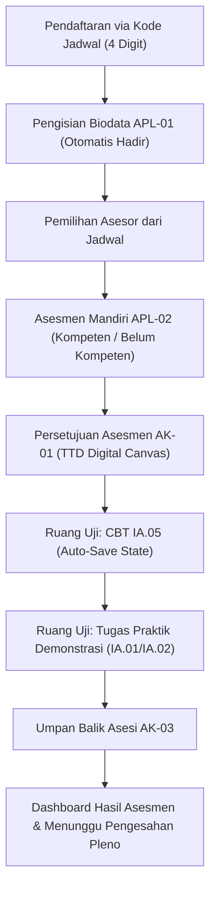
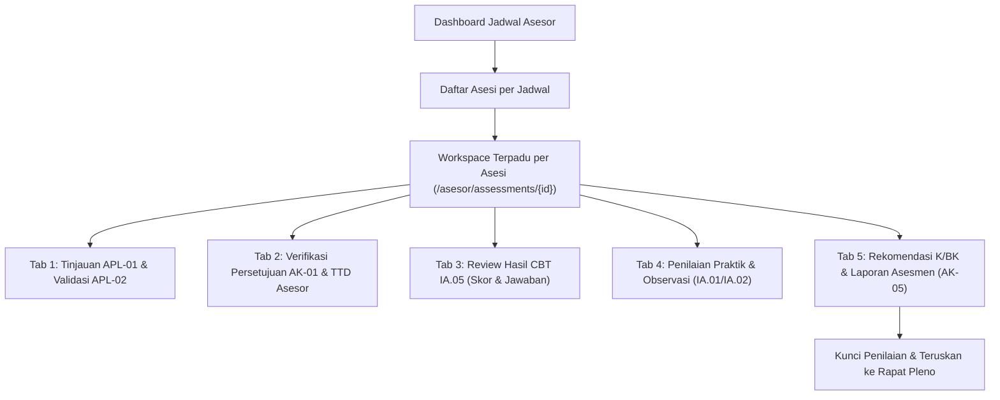

# Design Document: Refactor Alur (Flow), Tombol Aksi, dan Redirect Sistem LSP ProIndo

**Tanggal:** 2026-11-02  
**Status:** DRAFT (Untuk Review Pemilik)  
**Branch Terkait:** `refactor/final-polish`  
**Sasaran:** Pembenahan Alur Inti (Goal B), Penataan Tombol & UI Responsif (Goal C), dan Eliminasi Redirect Berantai / Bloat (Goal D) sesuai Standar SOP BNSP (SKKNI 333-2020 & PBNSP 201/202).

---

## 1. Intent dan Latar Belakang

Aplikasi LSP ProIndo merupakan sistem sertifikasi kompetensi kerja bidang otomotif untuk 7 skema standar BNSP. Audit statis menunjukkan:
- Terdapat **111 pemanggilan `redirect()`** yang tersebar di controller Asesi, Asesor, dan Admin, yang menyebabkan redirect berantai (chain redirects), flashing screen, atau user tersangkut di halaman buntu.
- Jumlah tombol aksi pada tabel dan form terlalu banyak, ambigu, dan tidak memiliki hierarki visual (kurang menerapkan prinsip 1 primary action per screen).
- Terdapat divergensi antara simplifikasi agresif draf awal (yang membuang verifikasi dan pleno) dengan **SOP resmi BNSP (SOP-04, SOP-10, SOP-14)** yang mewajibkan adanya verifikasi kelayakan APL dan pengesahan hasil rekomendasi asesor melalui Rapat Pleno Komite Teknis.

Desain ini menetapkan restrukturisasi alur pengguna (Asesi, Asesor, Admin) yang linier, bersih, tanpa redirect bolak-balik, dengan tombol aksi yang fungsional dan rapat seperti standar sistem LSP profesional (contoh: LSPMI).

---

## 2. Goals, Non-Goals, & Anti-Goals

### 2.1 Goals
1. **Alur Asesi Linier (One Next Step):**
   - Asesi hanya melihat satu penunjuk tindakan utama (*"Langkah Berikutnya"*) di dashboard.
   - Urutan proses: Pendaftaran (Kode Jadwal 4 digit) -> Biodata & APL-01 (Kehadiran otomatis) -> Pilih Asesor dari Jadwal -> Asesmen Mandiri APL-02 -> Persetujuan AK-01 (TTD Digital Canvas) -> Ruang Uji CBT FR.IA.05 (auto-save jawaban, tahan refresh) -> Umpan Balik AK-03 -> Rekap Hasil & Status Pleno.
2. **Ruang Kerja Asesor Terpadu (Single Workspace per Asesi):**
   - Menghilangkan navigasi melompat-lompat antar 4-5 menu terpisah. Asesor bekerja pada 1 layar per asesi: validasi APL-02 -> verifikasi AK-01 -> periksa nilai CBT IA.05 -> observasi praktik IA.01/IA.02 -> penetapan rekomendasi K/BK (AK-05/AK-06) -> finalisasi.
3. **Alur Admin Terpadu & Cepat (SOP Compliant):**
   - Kelola Jadwal (Kode 4 digit, penetapan TUK & Asesor).
   - Verifikasi Berkas APL-01 dengan fitur *1-Click Batch Review* per jadwal.
   - Modul Rapat Pleno Komite (`/admin/pleno`) untuk pengesahan berita acara pleno, daftar hadir pleno, dan penerbitan nomor sertifikat BNSP.
4. **Eliminasi Redirect Berantai:**
   - Standarisasi siklus HTTP: Seluruh form POST/PUT menggunakan pola *Post-Redirect-Get (PRG)* ke route tujuan deterministik.
   - Pengecekan guard/middleware langsung me-render view yang sesuai atau redirect 1 tingkat (maksimal 1 jump) dengan flash error informatif.
5. **Rasionalisasi Tombol & Aksi:**
   - 1 Aksi Primer per layar (misal: "Kirim Asesmen Mandiri", "Simpan Rekomendasi Asesor", "Sahkan Rapat Pleno").
   - Maksimal 2 Aksi Sekunder per baris tabel.
   - Label aksi eksplisit (Kata Kerja + Objek, contoh: "Detail Asesi", "Cetak Berita Acara").
   - Aksi tidak relevan untuk status saat ini disembunyikan.

### 2.2 Non-Goals (Fase Ini)
- Tidak mendesain ulang sistem layouting PDF overlay / dompdf (dikerjakan pada Fase 2: Goal A PDF Fidelity).
- Tidak membuat akun login terpisah untuk Komite Teknis dan TUK (tetap 3 role: `admin`, `asesor`, `asesi`).
- Tidak mengubah struktur data 104 Unit Kompetensi dan 330 Soal yang sudah bersih di database.

### 2.3 Anti-Goals
- Tidak ada modal popup bersarang (*nested modals*) yang membebani layar handphone/tablet.
- Tidak ada validasi yang menghapus jawaban formulir saat gagal (*preserve old input*).
- Tidak ada error 403 mentah ketika pengguna salah membuka link role lain; arahkan otomatis ke dashboard masing-masing dengan notifikasi.

---

## 3. Pendekatan Arsitektur yang Dipilih

Dipilih **Pendekatan 1: Arsitektur Pragmatis Standar BNSP**.
- **Aktor:** Tepat 3 role (`admin`, `asesor`, `asesi`).
- **Konsolidasi Single Source of Truth Database:**
  - Seluruh sistem disatukan di atas **ProIndo Core Engine (Stack A)**: `Schedule` (`t_schedules`), `Assessment` (`t_assessments`), `Scheme` (`m_schemes`), `m_kuks`, `m_question_banks`.
  - Tabel legacy `assessment_schedules` dan `assessment_applications` dibersihkan/didepresiasi. Field sertifikat resmi (`no_sertifikat`, `tgl_terbit_sertifikat`, `masa_berlaku_sertifikat`) dan relasi `pleno_meetings` dipindahkan ke tabel inti `t_assessments` dan `t_schedules`.
- **Kebijakan Tanda Tangan Digital (Canvas 1-Kali):**
  - Mengikuti keputusan draf prompt: Tanda tangan digital digambar **1 kali** di profil pengguna via HTML5 canvas, lalu otomatis diinjeksikan ke formulir MUK (termasuk AK-01). Asesi cukup mencentang persetujuan kerahasiaan AK-01 tanpa harus menggambar ulang tanda tangan.
- **Pemisahan Lembar Asesi vs Rekap Jadwal:**
  - Workspace per-asesi (`/asesor/assessments/{id}`) hanya mencatat rekomendasi individual **FR.AK.02** (K/BK).
  - Laporan Asesmen Kolektif Jadwal (**FR.AK.05** & **FR.AK.06**) berada di level jadwal (`/asesor/jadwal/{schedule}/laporan-ak05`), dieksekusi setelah seluruh asesi pada jadwal tersebut selesai dinilai.
- **Aturan Kelulusan & Sertifikat BNSP:**
  - Sertifikat Kompetensi Berlogo Garuda BNSP hanya diterbitkan untuk peserta dengan rekomendasi **KOMPETEN (K)** yang telah disahkan di Sidang Pleno. Peserta **Belum Kompeten (BK)** tidak mendapatkan nomor sertifikat, melainkan lembar hasil asesmen dan hak banding (AK.04).
- **Penyelarasan SOP & High-Velocity Batch Approval:**
  - Admin merangkap sekretariat komite teknis untuk menjalankan Rapat Pleno (SOP-10) dan menetapkan data sarpras TUK (SOP-14).
  - Admin melakukan verifikasi administrasi APL-01 (SOP-04) dengan antarmuka cepat *1-Click Batch Approval* ("Setujui Semua Berkas Jadwal Ini"). Karena ritme uji di lapangan berlangsung cepat (*high-paced*), verifikasi berkas dirancang instan sehingga asesi tidak terhambat masuk ke Ruang Uji, sementara catatan kepatuhan verifikasi audit (admin_id, admin_status, approved_at) tetap terekam sah di database.
  - Asesor bertindak independen memberikan rekomendasi K/BK pada ruang kerja asesmen.
  - Penerbitan sertifikat hanya dapat dilakukan setelah Rapat Pleno disahkan oleh Admin/Komite.

---

## 4. Rincian Teknis Implementasi Alur

### 4.1 Alur Asesi (`asesi.*`)

#### Status State Machine Asesi:
1. `DRAFT`: Baru membuat pendaftaran / mengisi data diri.
2. `SUBMITTED`: APL-01 & APL-02 selesai dikirim, menunggu verifikasi.
3. `VERIFIED`: Berkas disetujui, siap masuk asesmen.
4. `ASSESSMENT`: Sedang dalam proses uji (AK-01, CBT IA.05, Praktik).
5. `REVIEW`: Asesor telah memberikan rekomendasi, menunggu Rapat Pleno.
6. `COMPLETED`: Pleno disahkan, sertifikat kompeten / belum kompeten terbit.

#### Controller & Route Refactoring:
- Konsolidasi [`RuangUjiController.php`](file:///home/wahyuandika/Dokumen/coding-experiment/rea-application-lsp/app/Http/Controllers/Asesi/RuangUjiController.php) dan [`AplController.php`](file:///home/wahyuandika/Dokumen/coding-experiment/rea-application-lsp/app/Http/Controllers/Asesi/AplController.php) untuk menghapus 27 redirect berulang.
- Dashboard Asesi ([`DashboardController.php`](file:///home/wahyuandika/Dokumen/coding-experiment/rea-application-lsp/app/Http/Controllers/Asesi/DashboardController.php)) menghitung satu properti `$nextStep` yang memiliki label, rute tujuan, dan tombol aksi tegas.

### 4.2 Alur Asesor (`asesor.*`)

#### Controller & Route Refactoring:
- Satukan flow penilaian asesor ke dalam [`AssessmentExecutionController.php`](file:///home/wahyuandika/Dokumen/coding-experiment/rea-application-lsp/app/Http/Controllers/Asesor/AssessmentExecutionController.php) atau Workspace View terpadu.
- Hapus rute melompat-lompat antar [`Apl02ReviewController.php`](file:///home/wahyuandika/Dokumen/coding-experiment/rea-application-lsp/app/Http/Controllers/Asesor/Apl02ReviewController.php) dan menu instrumen terpisah.

### 4.3 Alur Admin (`admin.*`)
1. **Jadwal Asesmen:**
   - Form pembuatan jadwal ringkas: Skema Sertifikasi, Tanggal Pelaksanaan, Pilihan TUK, Plotting Asesor, dan Generate Kode Unik 4 Digit.
2. **Verifikasi Berkas APL (SOP-04):**
   - Halaman daftar peserta per jadwal dengan status verifikasi.
   - Tombol *"Setujui Semua Berkas Jadwal Ini"* untuk batch-verifikasi instan tanpa klik satu per satu.
3. **Rapat Pleno Komite (SOP-10):**
   - Masuk ke `/admin/pleno/{schedule}`.
   - Menampilkan tabel rekapitulasi rekomendasi dari asesor (K/BK per asesi).
   - Input nomor Berita Acara Pleno, tanggal pleno, tempat, dan nama Ketua Komite Teknis.
   - Tombol *"Sahkan Hasil Rapat Pleno & Terbitkan Nomor Sertifikat"*.
   - Tombol cetak Berita Acara Pleno dan Daftar Hadir Pleno.

---

## 5. Rencana Penataan Tombol & UI (Goal C)

- **Fidelitas Tata Letak Formulir Resmi (Form Layout Parity):**
  - Pada formulir asesmen (khususnya APL-01, APL-02, AK-01), antarmuka web mengadopsi susunan formulir resmi BNSP: Header identitas asesi di bagian atas, tabel skema sertifikasi, dan tabel data compact yang presisi.
  - Tampilan tetap modern, anti-slop, dan tenang: tanpa gradien norak, tanpa shadow tebal, tanpa sudut membulat berlebihan.
- **Tabel Data Rapat & Jelas:** Mengikuti referensi antarmuka sistem LSP profesional (LSPMI):
  - Menggunakan font sistem yang bersih (`font-sans`), ukuran teks compact (`text-xs` / `text-sm`), padding tabel hemat (`px-3 py-2.5`).
  - Menghilangkan dekorasi berlebihan (*AI slop*): tanpa gradien mencolok, tanpa shadow tebal, tanpa sudut kartu membulat ekstrem.
  - Border tabel tegas menggunakan palette slate/zinc netral (`border-slate-200`).
- **Standar Tombol & Aksi:**
  - *Satu Aksi Utama per Layar:* Maksimal 1 tombol aksi utama (Primary) yang menonjol (`bg-slate-900` atau `bg-blue-900`, teks putih).
  - *Maksimal 1-2 Aksi Sekunder:* Tombol sekunder dalam bentuk border abu netral (`border border-slate-300 bg-white text-slate-700 hover:bg-slate-50`). Tombol berlebih digabung/dihapus.
  - *Label Kata Kerja + Objek:* Menggunakan label eksplisit seperti "Simpan Data Diri", "Kirim Asesmen Mandiri", "Unduh Paket MUK", bukan "Submit" atau "OK".
  - *Aksi Merusak Butuh Konfirmasi:* Aksi hapus/tutup memerlukan modal konfirmasi tegas.
  - *Aksi Tidak Relevan Disembunyikan:* Sembunyikan tombol yang belum waktunya aktif, jangan mendisabled tanpa kejelasan.
  - *Validasi Inline & State Error:* Validasi berbahasa Indonesia yang jelas, nilai input lama (`old()`) dipertahankan saat gagal validasi, serta halaman error (401/403/404/419/500) dan empty state yang rapi.
  - *Navigasi Bersih:* Dilengkapi breadcrumb atau tombol kembali yang konsisten sehingga tidak ada jalan buntu.
- **CBT Resiliency (Anti-Hilang Saat Refresh/Putus Koneksi):**
  - Di halaman CBT (FR.IA.05), jawaban pilihan ganda disimpan seketika di sisi klien (*localStorage*) dan/atau di-autosave via AJAX ke backend, sehingga jawaban tidak hilang saat halaman di-refresh atau koneksi terputus sesaat.

---

## 6. Apa yang Dikerjakan oleh Builder (Task Breakdown)

1. **Audit & Pembongkaran Redirect Berantai:**
   - Audit seluruh 111 pemanggilan `redirect()` di controller Asesi, Asesor, dan Admin.
   - Ganti redirect memantul dengan direct routing atau render view berparameter.
2. **Refactor Dashboard & Flow Asesi:**
   - Perbaiki mekanisme pemilihan asesor dari jadwal.
   - Pasang kartu *"Langkah Berikutnya"* di dashboard asesi.
   - Pastikan auto-save jawaban CBT (FR.IA.05) aman di session/database saat reload.
3. **Refactor Workspace Asesor:**
   - Satukan penilaian asesi dalam 1 halaman kerja (tabbed interface tanpa reload).
4. **Perapian Modul Admin:**
   - Pasang tombol batch verifikasi APL.
   - Integrasikan finalisasi pleno dengan status sertifikat asesi.
5. **Role Guarding Middleware:**
   - Perbaiki `RoleMiddleware` agar redirect langsung ke dashboard pengguna masing-masing jika mencoba akses route terlarang.
6. **Automated Testing & Verifikasi:**
   - Buat feature test untuk alur lengkap: Register asesi -> APL-01 -> APL-02 -> AK-01 -> CBT -> Asesor Menilai -> Admin Pleno.
   - Pastikan seluruh test hijau.
